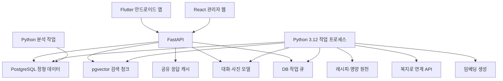
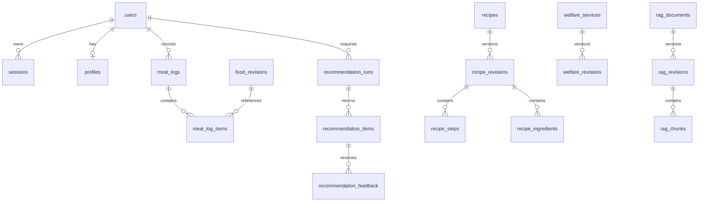
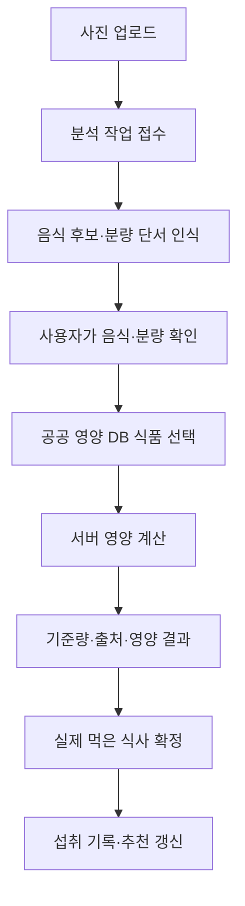

# ValueFlow AgeTech 구현계획서

**기준 문서:** [최종 기획서 v2.2](최종기획서.md)

**수정일:** 2026-11-06 · v2.2(검증 근거·역산 일정·기관 BM 반영)

**개발 기준:** Flutter·안드로이드 / React 관리자 웹 / Python 3.12 공통 FastAPI·별도 worker / PostgreSQL+pgvector·서버 파일 저장소

**현재 코드:** [앱 README](../../src/frontend/README.md) · [구현 커밋 c9986d4](https://github.com/dlwlssud123/SoftwareProject/commit/c9986d4019404cf47bd48f69e21d7fc117b4d7bb)

이 문서는 최종 기획서 v2.2의 범위를 구현으로 연결하는 계획이다. 10/31 사용자 결정으로 커뮤니티·하루 영상은 후속, 단순 달성 반응·음성 ‘다음’·제철 재료 추천/쿠팡 링크·급식소 안내는 이번 개발이다. 기존 식단/복지 확장·공유·기록 UI·생활 가이드를 함께 개발한다. 세부 날짜는 15.2절의 Asana 역산 일정, 미검증 범위는 15.1절을 따른다.

**기술 구성:** Flutter·React 관리자·Python 3.12 공통 FastAPI·별도 worker·PostgreSQL+pgvector·서버 파일 저장 유지. 음성 인식은 실제 Android 지원 확인, 쿠팡은 외부 링크만 사용한다. 새 영상 처리·커뮤니티 모듈을 선행 구축하지 않는다.

**빠른 이동:** [Flutter 앱](#flutter) · [DB 설계](#storage) · [레시피·추천](#recipes) · [복지 갱신](#welfare) · [RAG](#rag) · [영양분석](#nutrition) · [API](#api) · [평가](#evaluation) · [운영](#operations) · [일정·담당](#milestones)

> 구현 현황과 시험 수치는 11/06 기준이다. 현재 동작하는 인증·권한과 API는 [API 명세서](API_명세서.md), 이후 결정한 임베딩 모델과 운영 방향은 [RAG 임베딩 모델 결정안](../data/rag_embedding_decision.md)을 따른다.

## 1. 구현 기준과 범위

### 1.1 현재와 계획의 구분

| 구분 | 현재 확인된 상태 | 예정 구현·결정 |
| --- | --- | --- |
| 사용자 앱 | Flutter 안드로이드, 5개 탭·글자 확대·TTS·오프라인 추천 | 서버 API·상태 처리 연결. iOS는 별도 후속 검증 |
| 서버·데이터 | FastAPI 공통 기반·health 2개·DB 세션·원천 판본 모델·적재 CLI·갱신/실패 복구 시험 | 업무 API·사용자/식사 기록·검색/AI·관리자 연결과 실제 종단간 검증은 남음 |
| 저장소 | 공개 JSON·이미지를 앱에 포함 | PostgreSQL 정형·JSONB 원본·판본과 pgvector 검색 자료 |
| 레시피 | API 50건·이미지, 고정 규칙 추천·알레르기 필터·전체 조리 단계 | 데이터 품질 검증·서버 저장·다양성·프로필·확정 섭취 이력 기반 추천 |
| 복지 | 목록 461건 확인 후 전국 사업 6종 상세 수집·공식 링크 | 지자체 데이터·지역 필터·변경 감지·RAG |
| API 접근 | 식품·중앙부처 복지 인증과 수집 완료 | 지자체 API의 별도 승인·호출 조건·표본 확인 |
| 사용자 정보 | 프로필은 메모리에서 일회성 사용. 글자·음성 설정만 기기 저장 | 사용자 식별·프로필·동의·본인 기록·수정·삭제 |
| 사진·AI | 사진 선택과 별도 예시 결과, 사용법 예시 대화 | 외부 모델·공공 식품 코드·사용자 확인·서버 계산·근거 답변 |
| 관리자 | 실행 가능한 관리자 웹 없음 | React 운영·가이드/제철/시설 검수 UI와 공통 FastAPI 연결 |
| 추가 기능 | 채택 확장 기능은 미구현 | ADD-01~03·05~09와 기록 UI 개발. ADD-04 커뮤니티·개인 영상은 후속. 직접 주문/배송·추천 만족도 보류 |

앱의 현재 조회 경로는 **공공 API → Python 수집 → 번들 JSON·이미지 → Flutter 앱**이다. 별도로 FastAPI health·DB 적재·자료 갱신 기반이 존재하지만 앱의 업무 API 경로와 연결된 것은 아니다. 다음 장의 서버·worker·DB 구조와 이후 기술 수치·규격은 구현 예정 설계이며 완료 기능을 뜻하지 않는다. 주기·TTL·가중치·청크·보관 시간 등은 초기 설계값으로 실제 호출 조건·표본·시험에 따라 확정한다.

### 1.2 저장 역할

| 저장 영역 | 저장 내용 | 사용 이유 |
| --- | --- | --- |
| 관계형 테이블 | 레시피·재료·조리 단계·영양 수치·사용자·섭취·피드백·복지 메타데이터 | 정확한 식별자 연결, 조건 필터, 영양 계산, 이력 관리 |
| JSONB 원본 | 공공 API 응답을 정규화한 원본·수집 이력 | 원천과 가공 결과 대조, 필드 변경 대응 |
| pgvector | 레시피 설명·건강 문서·복지 설명의 청크와 임베딩 | 의미 검색·근거 검색 |
| 공유 캐시 테이블 | 공개 상세 정보·조건별 후보·콘텐츠 목록 | 다중 API 프로세스에서 반복 가공 결과 재사용 |
| 서버 파일 저장소 | 수집 스냅샷·임시 이미지·보고서, 향후 채택한 영상 등 산출물 | DB에는 경로·메타데이터. 비공개 파일 권한과 보관/복구 확인 |

레시피는 **정형 데이터와 검색용 설명을 함께 저장**한다. 재료 제외·영양 수치 비교는 관계형 조회로, 자유 질문·유사 메뉴 찾기는 벡터 검색으로 처리한다. 원본·수치·판본과 임베딩을 서로 연결해 운영한다.

## 2. 시스템 구성 및 구현 순서



초기 구성은 `api`, `worker`, `postgres` 세 실행 영역으로 시작한다. 데이터 수집·임베딩·사진 처리는 작업 프로세스가 맡고, API 프로세스는 사용자 요청과 상태 조회를 담당한다. FastAPI의 프로세스 내 후속 작업은 짧은 보조 작업에 적용하며, 지속적인 수집·재시작 복구가 필요한 작업은 DB 상태와 별도 작업 프로세스로 관리한다. [6]

**구현 순서:** 기존 기능 범위·API 계약 → DB·원천 품질 → 앱 통신·프로필·식품 매핑 → 개인화·갱신 → 사진 계산·RAG → 도우미·콘텐츠·관리자 연결 → 평가·배포. 상세 날짜는 15.2절을 따른다. 채택 기능은 15.2절 일정에 반영돼 있으나 실행 증거·공수와 인계 계약을 확인해야 한다. 보고서 D5의 대안 선택은 아직 미결정이다.

<a id="flutter"></a>

## 3. Flutter 안드로이드 앱 구현

### 3.1 현재 구조

```text
src/frontend/
  lib/
    app.dart                  앱·하단 탭·네비게이션·글자 설정
    data/demo_repository.dart JSON 로드·현재 고정 추천 규칙
    models/                   추천 모델·재료 표시 파싱
    screens/                  식단·복지·영양·도우미·콘텐츠·설정
    services/settings.dart    글자·음성·기기 설정
    widgets/common.dart       큰 버튼·안내·공통 표시
  assets/data/                레시피·복지 JSON과 수집 출처
  assets/images/              공개 레시피 이미지
  tool/                      Python 수집·실행 스크립트
  test/                      단위·위젯 테스트
  integration_test/          Android 대표 흐름 검증
```

현재 앱은 서버 HTTP 클라이언트 없이 포함된 JSON을 읽는다. 예정 통신 계층은 공통 APIClient·DTO·오류 변환으로 분리하고 기존 화면 모델과 연결한다. HTTP 의존성은 구현 착수 시 선정하며 현재 설치된 것으로 기술하지 않는다.

### 3.2 통신·상태·보관 계획

- HTTPS·JSON 응답의 ID·단위·기준량·출처·판본·확인 시각을 유지한다.
- 초기·대기·결과·빈 목록·추가 확인·오류·재시도를 구분하고 화면 종료 시 요청·사진 상태 조회를 중지한다.
- 음식·분량 수정과 실제 섭취 확정은 별도 동작으로 처리하고 요청 키·판본으로 중복을 제어한다.
- 글자·음성은 현재 `shared_preferences`로 보관한다. 향후 인증 토큰은 기기 보안 저장 수단을 선정하며 일반 설정 저장과 구분한다.
- 현재 오프라인 데이터는 시연 기준이다. 서버 전환 후의 캐시·오프라인 정책을 명시하고 최신 조회로 오인시키지 않는다.

### 3.3 기능별 연결

| 기능 | 현재 동작 | 예정 연결 |
| --- | --- | --- |
| 식단·조리 | 조건 입력·최대 5건·영양·재료·전체/단계별 조리·읽어주기 | 저장 프로필·섭취 이력·추천 이유·데이터 판본 |
| 사진·영양 | `image_picker` 촬영/앨범·미리보기·별도 예시 | 업로드·음식/식품/분량 수정·계산·섭취 확정 |
| 도우미·복지 | 예시 대화·복지 6종·공식 링크·TTS | 실제 질의·지역·검색 근거·추가 질문·실패 안내 |
| 건강쇼츠·놀이터 | 외부 영상 검색·같은 그림 찾기·주제 메모 | 확인된 영상·장소·주제 API와 오류·중지 상태 |
| 설정 | 글자 100·120·140%, 기기 TTS | Android 화면 읽기·터치·동의·본인 기록 관리 검증 |
| 추가 기능 | 신규 확장 미구현 | 식단/저장/장보기·복지·공유·가이드·급식시설·단순 달성·음성 다음·제철/쿠팡 링크 연결. 커뮤니티/영상 후속 |

사진·읽어주기는 현재 선택한 `image_picker`·`flutter_tts`를 유지한다. Android 접근성·글자 확대·색 이외의 구분·음성 중지·입력 복구를 시험한다. iOS 전용 PhotosPicker·Keychain·VoiceOver 구현을 완료한 것으로 간주하지 않는다. [9][10][11]

## 4. Python 3.12 백엔드·데이터 작업 구조

```text
backend/
  app/
    main.py              앱 생성·라우터 등록
    api/                 auth·profile·recipes·nutrition·assistant·welfare·videos·admin
    schemas/             요청·응답·검증 모델
    services/            추천·영양 계산·대화·콘텐츠 운영
    repositories/        DB 조회·저장·판본 전환
    integrations/        recipe_api·welfare_api·llm·kakao·video·map
    rag/                 청킹·임베딩·후보 검색·근거 구성
    jobs/                작업 정의·실행·재시도·정기 갱신
    core/                설정·인증·오류·로그·공통 규칙
  migrations/            Alembic DB 변경
  tests/                 고정 자료·권한·계산·갱신·통합 시험
  pyproject.toml
  uv.lock
data/
  raw/                   원천 스냅샷
  processed/             가공·매핑·평가 자료
  analysis/              Python 분석 스크립트·노트북
  reports/               그래프·품질·평가 결과
```

라우터 → 서비스 → 저장소 접근·외부 연결의 방향을 유지한다. 추천·계산은 직접 시험할 수 있는 함수로 분리하고, LLM·공공 API는 외부 연결 인터페이스로 감싼다. API·worker·분석 모두 동일 Python 3.12 및 잠금 파일을 사용한다. SQLAlchemy 세션은 요청·작업 단위로 관리하고 병렬 작업마다 분리한다. [12]

## 5. 사용자 식별·개인화 자료

### 5.1 공통 사용자 모델

프로필·섭취·추천·피드백의 기준은 내부 `user_id`다. 인증 방식은 사용자와 연결하는 별도 영역으로 둔다.

| 방식 | 구현 흐름 | 기록 연결 |
| --- | --- | --- |
| 세션 우선안 | 서버가 게스트 사용자·세션·검증 가능한 임의 토큰 발급 → 앱의 선정할 보안 저장소 보관 → 요청 시 토큰 확인 | 동일 사용자의 프로필·확정 섭취 기록 연결 |
| 카카오 연동안 | Flutter 카카오 로그인 연계 후보 → 서버에서 제공자 자격 확인 → 카카오 식별자를 내부 사용자에 연결 → 서비스 세션 발급 | 계정 기준으로 프로필·이력 연결 |

게스트 세션 API의 구현 범위는 [API 명세서](API_명세서.md)를 따른다. 앱의 보안 저장소 연결, 만료 후 사용자 복구와 카카오 연동은 후속 작업이다. 카카오의 원천 계정 정보와 서비스의 식사 조건·섭취 기록은 별도 동의·입력 과정으로 관리한다. [13]

세션 ID는 식별용이며 개인 자원 접근은 토큰·만료·소유 사용자로 검사한다. 토큰 해시는 DB에 저장하고 폐기·갱신 상태를 관리한다. 세션 만료 후 기록 연결과 기기 변경 정책은 로그인 범위 결정 시 함께 확정한다.

### 5.2 프로필·이력

초기 프로필은 선호 재료, 제외 재료, 식사 조건, 동의 상태를 중심으로 구성한다. 복지 조회에 지역·연령대가 필요한 경우 목적을 안내하고 사용자가 선택하도록 한다. 건강 조건은 검토한 문서·추천 규칙과 연결해 적용한다.

확정 섭취에는 실제 먹은 음식·선택한 식품 판본·분량·섭취 시각을 저장한다. 추천 노출·메뉴 선택·사진 분석과 섭취 확정을 서로 다른 사건으로 관리한다. 메뉴를 보거나 사진을 인식한 결과는 사용자 확인을 통해 실제 섭취 기록에 연결한다.

사용자·프로필·이력의 버전을 변경하고 개인 추천 캐시를 갱신한다. 수정·삭제·동의 철회는 사용자 화면과 API에서 처리하고, 시험 자료에는 합성 프로필·이력을 사용한다.

<a id="storage"></a>

## 6. PostgreSQL·pgvector 저장 설계

### 6.1 주요 테이블

이하 표는 예정 DB다. 현재 저장소에 해당 DB·마이그레이션은 없다. `recommendation_feedback`·`ingredient_product_links` 등 추가 기능 전용 테이블·경로는 조건부 설계이며 팀 합의 전 선행 구현하지 않는다.

| 영역 | 테이블·키 | 주요 내용 |
| --- | --- | --- |
| 사용자 | `users`, `auth_identities`, `sessions`, `profiles` | 내부 ID·인증 연결·동의·프로필 버전 |
| 레시피 | `recipes`, `recipe_revisions`, `recipe_steps`, `recipe_ingredients`, `recipe_nutrients` | 원천 ID·게시 판본·단계·재료·기준량·영양 |
| 식품 | `foods`, `food_revisions`, `food_nutrients`, `food_name_mappings` | 원천 코드·판본별 ID·영양·음식명 매핑 |
| 추천·섭취 | `recommendation_runs`, `recommendation_items`, `meal_logs`, `meal_log_items` | 조건·후보·점수·추천 버전·확정한 섭취 |
| 사진 | `nutrition_analyses`, `analysis_items` | 작업 상태·음식 후보·확인 식품·분량·부분 계산 |
| 복지 | `welfare_services`, `welfare_revisions` | 제공자와 서비스 ID·원문·지역·게시 판본·유효성 |
| 문서·벡터 | `rag_documents`, `rag_revisions`, `rag_chunks`, `embedding_jobs` | 문서·판본·청크·해시·벡터·임베딩 모델 |
| 대화 | `conversations`, `messages`, `answer_citations` | 사용자별 대화·요약·답변에 실제 사용한 근거 |
| 콘텐츠·추가 | `videos`, `video_themes`, `recommendation_feedback`, `ingredient_product_links` | 영상·피드백·확인한 상품 및 주문 링크 |
| 운영 | `cache_entries`, `job_runs`, `sync_runs`, `api_usage`, `admin_users`, `audit_logs` | 캐시·갱신·작업·할당량·관리자·변경 |

자료는 원천 ID와 내부 ID를 함께 보존한다. `provider + source_id`가 자료의 식별 기준이고, 변경된 본문은 별도 revision으로 생성한다. 조회는 각 자료의 `active_revision_id`를 따라간다. 오래된 판본은 이력·평가·확정 결과의 근거를 재현하는 데 활용한다.

### 6.2 핵심 관계



원천 자료와 RAG 문서는 자료 유형·원천 판본 ID로 연결한다. 동일 원천의 가공 텍스트·해시·임베딩 모델·청크 판본을 기록해 원문 수정과 검색 결과를 함께 추적한다.

### 6.3 벡터·검색 인덱스

11/07 모델 결정안에 따라 KURE-v1 임베딩을 `vector(1024)`로 저장하고, 초기 규모에서는 코사인 거리로 정확 검색한다. 모델·revision과 게시 판본을 검색 조건에 사용한다. 색인 도입은 데이터 규모와 실측 결과에 따라 검토한다. [RAG 임베딩 모델 결정안](../data/rag_embedding_decision.md)

벡터 저장 항목은 `chunk_id`, `revision_id`, `embedding_model`, `embedding_revision`, `text_hash`, `embedding`, `created_at`이다. 본문 텍스트와 출처는 같은 청크·판본에 연결한다. 공개 레시피·복지·건강 문서를 corpus 유형으로 구분한다.

초기 표본은 정확한 유사도 검색으로 기준 결과를 만든다. 자료량이 늘면 cosine HNSW를 적용하고 같은 필터·질문에서 검색 품질·시간을 비교한다. 지역·게시 상태·활성 판본 필터 후 결과 수를 확인하며, 후보 부족 시 추가 탐색 또는 정확 검색으로 보완한다.

**제약·일반 인덱스:** 원천 ID·판본·청크 해시의 유일성, 사용자별 섭취 시각, 지역·게시 상태, 작업 상태·다음 실행 시각, 캐시 키·만료 시각을 중심으로 구성한다. 사용자 확인·영양 계산·섭취 확정은 트랜잭션으로 함께 저장한다.

<a id="recipes"></a>

## 7. 레시피 수집·전처리·캐시·개인화 추천

### 7.1 원천 연결

COOKRCP01은 인증키, XML 또는 JSON, 조회 시작·끝 위치를 사용하며 `CHNG_DT`로 특정 변경일 이후 자료를 조회할 수 있다. [1]

| 원천 필드 | 내부 항목·처리 |
| --- | --- |
| `RCP_SEQ`, `RCP_NM` | 원천 레시피 ID·제목 |
| `RCP_PAT2`, `RCP_WAY2` | 요리 종류·조리방법 |
| `RCP_PARTS_DTLS` | 재료 원문·가공 항목·파싱 확인 상태 |
| `MANUALxx`, `MANUAL_IMGxx` | 비어 있지 않은 단계의 순서·설명·이미지 |
| `INFO_WGT`, `INFO_ENG`, `INFO_CAR`, `INFO_PRO`, `INFO_FAT`, `INFO_NA` | 원천 영양·중량 문자열, 숫자·단위·기준량 확인 결과 |
| `ATT_FILE_NO_MAIN`, `ATT_FILE_NO_MK` | 이미지 경로 |

출력에 있는 중량과 영양 필드의 계산 기준은 표본·원천 안내로 확인해 저장한다. 결측·확인 필요 값은 해당 상태로 관리하고 비교 가능한 항목만 추천·분석에 사용한다.

### 7.2 수집·갱신

1. 인증키를 서버 설정에 보관하고 표본 페이지로 응답·건수·식별자를 확인한다.
2. 전체 초기 수집은 페이지별 스냅샷·성공 위치를 기록하며 진행한다.
3. 원본, 숫자·단위 정리, 재료 파싱, 단계 정리, 중복·누락 검증을 거친다.
4. 유효한 자료를 새 판본으로 적재하고 검색용 텍스트를 생성한다.
5. 청크·임베딩이 준비된 판본을 게시하고 레시피 캐시의 자료 버전을 변경한다.
6. 이후 하루 1회 변경일 조회를 시작값으로 사용한다. 같은 날짜의 변경을 포함하도록 이전 성공일을 겹쳐 조회하고 ID·해시로 중복 처리한다.
7. 원천 전체 ID 점검은 할당량에 맞춘 별도 작업으로 수행한다. 부분 조회에서의 누락은 다음 전체 점검과 구분한다.

레시피 API의 키가 URL 경로에 포함되는 형태를 고려해 호출 로그의 인증 구간을 마스킹한다. 외부 요청 URL은 서비스 설정의 원천으로 제한한다.

### 7.3 재료와 검색 텍스트

자유형 재료 원문을 보존하고 `재료명·필요량·단위·확인 상태`를 추출한다. 괄호·복합 단위·선택 재료 등은 규칙과 표본 검수로 처리한다. 제외 재료는 확정한 매핑과 원문 표현을 함께 확인하고, 제외 조건 관련 불명확 항목은 검토 상태로 관리한다.

검색 텍스트는 제목, 종류·조리방법, 재료, 조리 설명, 검토한 태그를 포함한다. 영양 수치는 관계형 원천 필드에 연결하여 설명·조건 비교에 사용한다. 시간대·식감·건강 관련 태그는 원천 항목과 팀의 검토 태그를 구분한다.

### 7.4 서버 캐시

초기 캐시는 PostgreSQL의 `cache_entries`로 공유하고, Redis는 측정 후의 확장 후보로 둔다.

| 대상 | 키에 포함할 조건 | 초기 TTL |
| --- | --- | --- |
| 공개 레시피 상세 | 레시피 ID·게시 판본·언어 | 6시간 |
| 공개 조건 후보 | 시간대·선호·제외 조건 해시·데이터 버전 | 10분 |
| 개인 추천 | 사용자 ID·프로필·섭취·피드백 버전·조건·추천 모델 및 데이터 버전 | 5분 |
| 복지 목록 | 지역·분류·검색 조건·게시 데이터 버전 | 30분 |

개인 추천과 일반 후보를 구분한다. 사용자 기록 변경 시 해당 버전을 증가시키고, 원천 게시·숨김 변경 시 데이터 버전을 갱신한다. 만료 시간 외에 상태·소유·현재 판본을 확인한 결과만 반환한다.

### 7.5 개인화 추천

처리 순서는 사용자 확인 → 프로필·최근 확정 섭취 조회 → 제외 조건 필터 → 시간대·재료·영양 및 검색 후보 생성 → 순위 계산 → 후보 다양성 적용 → 이유·근거 저장이다.

기준 모델은 시간대별 조건 필터·무작위 후보이고, 개선 모델은 조건·선호·최근 이력·피드백을 반영한 규칙 기반 순위다. 초기 비교식은 다음과 같다.

```text
score = 0.35 × preference
      + 0.25 × meal_time_match
      + 0.20 × diversity
      + 0.20 × feedback_preference
```

각 항목은 0~1로 정의하고 가중치·알고리즘 버전을 기록한다. 이력이 적은 사용자는 사용할 수 있는 항목의 가중치를 재정규화한다. 최근 7일을 초기 다양성 평가 구간으로 두고, 이미 먹은 메뉴·재료의 반복을 완화한다. 명시적인 제외 조건은 점수 계산 전 필터로 적용한다.

영양·건강 상태별 제한은 검토한 기준을 별도로 관리해 후보 필터에 연결한다. 설명에는 실제 반영한 선호·시간대·이력의 이유를 제공한다. 확정 섭취 이력이 적으면 선호·시간대 중심으로 추천하고, 관련 자료가 축적되면 이력·피드백을 추가 반영한다.

<a id="welfare"></a>

## 8. 복지로 API 수집·변경 감지·Vector DB 갱신

### 8.1 API 접근과 남은 작업

중앙부처복지서비스는 인증·수집 완료 상태다. 수집기는 활용가이드 v2.2의 `https://apis.data.go.kr/B554287/NationalWelfareInformationsV001`에서 목록·상세를 조회했다. 2026-10-26 기준 목록 461건을 확인하고 전국 사업 6종의 실제 상세 정보를 앱에 포함했다. [2]

| 대상 | 현재 상태 | 남은 작업 |
| --- | --- | --- |
| 중앙부처 | 앱 전국 6종. 별도 로컬 DB 목록 461·상세 80·대기 381건 적재 기록 | 상세 재개·변경 감지·호출 예산·RAG·앱 연결. [적재 절차](../data/welfare_db_import.md) |
| 지자체 | 별도 수집·지역별 안내 미구현 | 해당 서비스의 활용신청·승인·필드·지역 코드·표본 확인 후 수집 [3] |
| 현재 결과 | 전국 사업으로 안내하며 실제 수급 자격을 판정하지 않음 | 지역 사업과 전국 사업 구분·원문·확인 시각 유지 |

중앙부처 실제 필드는 `tool/fetch_welfare_data.py`와 앱 JSON에서 대조한다. 지자체 서비스는 중앙부처 키의 사용 가능 여부를 별도로 확인한다. 호출량은 승인 계정의 실제 한도로 설정하고 소개 페이지의 기본값을 승인 한도로 단정하지 않는다. 인증키는 서버 환경변수 또는 Git 무시 대상 `.env`에서 읽는다.

### 8.2 내부 복지 데이터

| 항목 | 의미 |
| --- | --- |
| `provider`, `source_service_id` | 중앙·지자체 구분과 원천 서비스 ID |
| `title`, `summary`, `target_text`, `selection_text` | 제목·개요·대상·선정 기준 |
| `benefit_text`, `application_text`, `contact_text` | 지원 내용·신청 방법·문의 정보 |
| `region_scope`, `region_codes`, `category_tags` | 조회·검색에 사용할 지역·분류 |
| `source_url`, `source_modified_at` | 확인한 공식 원문과 제공되는 수정 시각 |
| `content_hash`, `revision`, `status` | 본문 변경·판본·게시 및 확인 상태 |
| `collected_at`, `last_checked_at`, `last_seen_run_id` | 수집·원천 재확인·스캔 추적 |
| `active_revision_id`, `rag_document_id` | 게시 원문과 검색 청크 연결 |

원천이 제공하는 값은 보존하고, 제공 여부를 확인해야 할 수정 시각·정형 신청 기간 등은 상태와 원문을 함께 관리한다. 신청 조건은 문자열·정형 후보를 구분해 저장한다. 각 지역 범위와 필터 코드는 공식 코드표에 맞춰 매핑한다.

### 8.3 주기·호출량

목록 점검은 하루 1회를 초기 목표로 잡는다. 상세 점검은 신규·변경 후보를 우선하고, 나머지는 마지막 확인 시각 순으로 나누어 조회한다. 상세 변경 신호가 있는 경우 신호를 활용하고, 전체 상세 순환 점검으로 목록에 드러나지 않는 변경도 확인한다.

```text
가용 호출량 = 승인 호출 한도 − 오늘 사용량 − 재시도·운영 예약량
주기 작업 호출량 = 목록 페이지 수 + 상세 조회 수 + 재시도 수
상세 순환 기간 = 전체 상세 대상 수 / 하루에 처리 가능한 상세 수
```

80% 사용을 초기 작업 상한으로 두어 표본·재시도 여유를 확보한다. 실제 단위·상한은 승인 계정에서 확인한다. 할당량으로 하루 전체 상세 확인이 어려우면 최초 적재·점검을 여러 날에 나누고 API 증설을 검토한다. 관리자에는 목표 주기와 실제 최근 전체 점검·상세 확인 시각을 구분해 표시한다.

### 8.4 변경 감지 및 게시 전환

1. provider·스캔 범위·시작 시각으로 수집 run을 생성하고 중복 실행을 제어한다.
2. 페이지·건수·성공 코드를 확인하고 원천 목록의 ID·정규화 해시를 수집한다.
3. 새 ID·변경 후보·상세 순환 대상을 호출 예산에 맞춰 큐에 등록한다.
4. XML의 반복·단일 항목, HTML·공백·순서·인코딩을 정리하고 의미 필드의 canonical JSON을 생성한다.
5. 제목·대상·선정 기준·지원 내용·신청 방법·문의처·지역·출처의 해시로 변경을 비교한다. 수집 시각은 내용 해시에서 분리한다.
6. 변경된 원문은 새 revision으로 저장하고 임베딩 작업을 등록한다. 동일 본문은 확인 시각만 갱신한다.
7. 청킹·임베딩·출처·필터 검증 후 **원문과 RAG의 활성 판본을 한 트랜잭션으로 전환**한다. 신규 자료는 준비 상태에서 게시로 이동한다.
8. 복지 캐시 버전을 증가시키고 이전 청크는 활성 판본 조회에서 제외한다.
9. 현재 범위의 전체 목록을 성공적으로 완료한 run에서만 누락 ID를 점검한다. 부분 실패·중단·검색 범위 변경은 삭제 판정과 구분한다.
10. 종료·삭제 신호 또는 연속 전체 점검의 누락을 확인해 비활성 처리한다. 관리자에는 근거·확인 횟수·마지막 원천 확인을 표시한다.

이 절차의 상태와 hash 비교는 프로젝트가 구현할 변경 감지 방식이다. 원천의 실시간 제공 안내와 우리 서버의 실제 동기화 완료 시점을 별도 기록한다.

본문·조리 단계처럼 순서가 의미인 항목은 원래 순서를 유지하고, 순서와 무관한 태그만 정렬해 해시를 만든다. 게시 전환 시 해당 판본이 최신 게시 대상이고 서비스가 활성 상태인지 다시 확인한다. 늦게 끝난 이전 임베딩 작업은 최신 판본·철회 상태를 덮어쓰지 않도록 조건부 전환한다.

### 8.5 실패·재개

HTTP와 XML 내부 성공·오류를 함께 확인한다. 타임아웃·일시 오류는 제한된 지연 재시도, 승인·키 오류는 운영 확인, 할당량 초과는 다음 가용 시각으로 처리한다. 실패 페이지·상세 ID와 다음 실행 위치를 저장한다.

임베딩 실패 시 기존 활성 판본을 유지하고 변경 대기 상태·오래된 확인 시각을 표시한다. 원천에서 명시한 게시 철회·종료는 검색 후보에서 바로 비활성 처리한다. 전체 점검이 성공한 범위에서만 누락 판정을 진행하고, 마지막 성공 run으로 재현할 수 있도록 한다.

<a id="rag"></a>

## 9. RAG 인덱싱·검색·답변

### 9.1 검색 자료와 질문 경로

| 자료·질문 | 처리 경로 | 답변에 연결할 근거 |
| --- | --- | --- |
| 레시피 설명·조리법·유사 메뉴 | 레시피 조건 조회와 설명 검색 | 레시피 ID·활성 판본·조리 단계·공공 출처 |
| 음식별 영양 수치·합계 | 식품 코드·판본 조회와 서버 계산 | 식품 DB 출처·기준량·선택 분량·계산 결과 |
| 복지 대상·지원 내용·신청 방법 | 지역·게시 상태 필터와 복지 검색 | 서비스 ID·판본·원문 URL·확인 시각 |
| 건강·식생활 질문 | 검토한 공식 건강 문서 검색 | 문서 제목·발행처·출처·확인 시각 |
| 생활 대화·사진 풀이·장소 | 대화 모델·이미지 모델·지도 연결 | 모드에 맞는 결과와 외부 확인 경로 |

복지와 레시피·건강 자료를 corpus로 구분한다. 명시한 기능 모드와 질문 내용을 함께 사용해 검색 대상을 정하고, 복합 질문은 필요한 자료를 각각 조회한다. 영양 합계는 계산 서비스의 결과를 답변에 전달한다. 건강 문서는 국가건강정보포털 등 공식 자료에서 이용 조건·내용·게시 상태를 검토한 후 등록한다. [19]

### 9.2 청킹 규격·메타데이터

문서의 제목·소제목·목록·조리 단계를 유지하고 HTML·중복 공백·반복 안내를 정리한다. 복지는 대상·선정 기준·지원 내용·신청 방법을 구분하되 문맥이 필요한 조건·예외는 같은 청크에 배치한다. 레시피는 제목·재료·단계·설명에 따른 구획을 만든다.

청크의 초기 기준은 [RAG 임베딩 모델 결정안](../data/rag_embedding_decision.md)의 원천별 구획과 길이 기준을 따른다. 짧은 구획은 의미 단위로 합치고 긴 구획은 문장 경계에서 나눈다. 모델 입력 한도·검색 결과·답변 근거를 확인하여 크기와 겹침을 조정한다.

| 필드 | 규격·용도 |
| --- | --- |
| `document_id`, `revision_id`, `chunk_id`, `chunk_order` | 문서·판본·청크 식별과 원문 순서 |
| `corpus`, `provider`, `source_id`, `source_revision_id` | 자료 유형과 원천 연결 |
| `title`, `section`, `text`, `text_hash` | 검색 본문·구획·중복 검증 |
| `source_url`, `publisher`, `checked_at` | 사용자에게 제시할 출처·확인 시각 |
| `region_codes`, `scope_type`, `tags` | 지역·전국 적용 여부·주제 필터 |
| `status`, `active_revision_id` | 게시·활성 판본의 검색 제어 |
| `embedding_model`, `embedding_revision`, `chunking_version` | 같은 검색 공간과 가공 규격 확인 |

지역 미확인 자료는 확인 상태를 별도 저장하고 지역별 후보와 구분한다. 국가 단위 자료와 해당 지자체 자료는 공식 적용 범위를 확인한 메타데이터로 함께 조회한다.

### 9.3 임베딩·검색 흐름

1. 유효한 새 판본의 텍스트·메타데이터를 생성하고 청크 해시를 확인한다.
2. KURE-v1 임베딩을 생성하고 차원·빈 값·청크 수를 검증한다. 질문에도 같은 모델·revision·설정을 적용한다.
3. 게시 상태·활성 판본·corpus·지역 등 필터를 적용해 의미 검색 후보를 구한다.
4. 제목·서비스명·재료의 정확·부분 일치 검색을 병행하고, 두 순위는 RRF 방식으로 결합하는 안을 비교한다.
5. 초기 후보 20개에서 중복·유사 청크를 정리하고 근거 3~5개를 선택한다. 같은 서비스의 여러 구획은 필요한 경우 함께 묶는다.
6. 질문·짧은 대화 요약·선택한 근거·응답 규격을 모델에 전달한다.
7. 답변의 인용 ID를 실제 제공한 청크에 대조하고 서버가 출처 URL·판본·확인 시각을 조립한다.

초기 키워드 검색은 PostgreSQL의 제목·정규화 이름 일치와 부분 일치로 구현한다. 한국어 형태소 기반 검색을 확장할 때는 별도 분석기·인덱스와 효과를 검토한다. HNSW는 같은 질문·필터의 정확 검색 결과와 비교하여 적용한다. [5]

### 9.4 답변 형식·판본·실패 처리

답변 DTO는 `answer`, `status`, `citations`, `related_recipe_ids`, `follow_up_question`을 공통으로 사용한다. `status`는 근거 답변·추가 확인·일시 오류를 구분한다. 인용은 검색에서 제공한 ID로 제한하고 URL은 DB의 원천 값을 사용한다. 구조화 출력은 형식 검증에 활용하며 내용의 정확성은 근거 검증으로 확인한다. [8]

복지 답변은 검색한 서비스의 조건과 신청·문의 경로를 설명하고, 개인의 해당 여부를 확인할 질문을 제시한다. 지역·소득 등 필요한 정보가 부족하면 추가 조건을 확인한다. 오래된 자료에는 최근 상세 확인 시각을 표시하고 최신 신청 가능 여부를 공식 경로에 연결한다.

원천 활성 판본과 RAG 활성 판본을 함께 조회해 이전·철회 청크를 제외한다. 임베딩 모델 교체는 새 검색 공간을 준비하고 평가한 후 전환한다. 검색 문서의 지시문은 자료로 처리하고 시스템 규칙·호출 권한과 분리한다. 사용자 대화·건강 입력은 공개 검색 corpus와 분리해 사용자별 접근을 검사한다.

LLM 연결부는 기존 제출본의 모델 후보와 공급자의 실제 지원 모델을 같은 자료에서 비교한 뒤 확정한다. 기존 후보명이 현재 선택·연동 완료를 의미하지 않는다. [7] 모델 선택·프롬프트·대화 요약·검색 후보 수를 설정으로 관리한다. 검색 부족은 질문 구체화로 연결하고, 모델 타임아웃에는 검색한 자료·출처를 보여주는 화면을 제공한다.

<a id="nutrition"></a>

## 10. 사진 인식·영양 분석 파이프라인

### 10.1 처리 단계와 상태



`nutrition_analyses`는 `queued → processing → awaiting_confirmation → calculated`로 관리하고 처리 실패는 `failed`에 원인 코드를 저장한다. 계산 후 수정하면 새 계산 판본을 생성한다. 실제 섭취 확정은 별도 `meal_log`로 연결한다.

### 10.2 사진 접수·모델 출력

접수 시 형식·실제 파일 내용·크기·해상도를 검사하고 EXIF를 정리한다. 초기 업로드 상한은 5MB로 두고 앱에서 크기를 조정한다. JPEG·PNG를 기본으로 하고 HEIC 사진은 앱에서 변환한다. API는 작업 ID와 상태 조회 주소를 `202 Accepted`로 반환하고 worker가 모델 요청을 처리한다. multipart 업로드는 FastAPI 파일 처리 규격을 사용한다. [16]

모델 출력은 음식명 후보, 눈에 보이는 구성, 분량 단서, 사용자에게 확인할 사항으로 제한한다. 각 항목을 Pydantic 모델로 검증하고 식품 후보 매핑에 넘긴다. 인식 모델의 주관적인 확신 정도와 측정한 분류 정확도를 구분한다. 분량·기름·양념처럼 사진만으로 확인하기 어려운 항목은 확인 상태로 표시한다. [7][8]

### 10.3 음식명·식품 코드·분량 매핑

1. 음식명 정규화·검토한 별칭으로 정확 후보를 찾는다.
2. 조리 형태·식품 분류·대표 음식명을 사용해 후보를 좁힌다.
3. 앱에서 음식명·식품 후보·분량을 확인하거나 검색해 수정한다.
4. 선택한 내부 `food_id`, `food_revision_id`와 원천 식품 코드·기준량을 저장한다.
5. g·mL·개·인분을 원천의 기준량 또는 검토한 환산표로 연결한다.

식품영양성분 DB의 식품코드·이름·영양성분 기준량·단위·출처를 보존한다. [14] mL와 g의 변환에는 식품별 밀도 또는 검증한 환산값을 사용한다. ‘한 그릇·한 개’는 선택 가능한 기준 분량과 사용자 수정으로 g에 연결한다. 환산값이 필요한 항목은 계산 전 확인하도록 한다.

### 10.4 계산 규격

```text
항목별 영양값 = 식품 판본의 기준 영양값 × 확인한 섭취량 / 해당 영양값의 기준량
식사 영양합계 = 계산 가능한 음식별 영양값의 합
```

계산은 단위 정규화 후 Python `Decimal`로 수행하고 저장 정밀도·화면 반올림을 분리한다. [15] 식품별 영양 필드의 기준량·단위가 일치하는지 검사한다. 에너지 kcal, 탄수화물·단백질·지방 g, 나트륨 mg 등을 응답 필드로 명시한다.

결측 영양 항목은 `null`, 계산 상태는 `partial`로 관리한다. 합계에는 해당 영양소의 계산 가능 음식 수·전체 음식 수를 함께 제공한다. 선택한 대표 식품·분량에 따른 추정 결과임을 화면에 설명하고 음식·양념·분량을 수정할 수 있게 한다.

### 10.5 수정·섭취 확정·사진 보관

계산 확인 요청은 분석 판본 번호를 함께 보내고, 다른 수정이 먼저 저장되었으면 최신 결과로 다시 확인한다. 섭취 확정은 사용자·요청 키·입력 해시를 검사해 한 번 저장한다. 섭취 시각·식품 판본·분량·영양 결과를 트랜잭션으로 연결하고 이력 버전·개인 추천 캐시를 갱신한다.

사진은 사용자별 접근이 적용된 임시 위치에 보관하고, 초기 보관 기준은 작업 종료 후 24시간 이내 삭제로 설정한다. 종료되지 않은 작업도 최장 보관 기한을 정해 정리한다. 삭제·동의 철회 요청은 대화·분석·섭취의 연결 자료와 함께 처리한다. 평가용 사진은 별도 이용 조건·동의를 확인해 분리 관리한다.

<a id="api"></a>

## 11. API·Flutter DTO 계약

### 11.1 공통 규격

신규 API는 `/api/v1`으로 묶고 OpenAPI 문서·표본 JSON을 앱 담당과 공유한다. 기업 제공 화면의 기존 경로·키와 호환이 필요한 항목은 대응표를 만들고 변환 계층에 반영한다. 날짜·시각은 ISO 8601 UTC로 전달하고 화면에서는 한국 시간으로 표시한다.

성공 응답은 `data`와 `meta`, 오류 응답은 `error`와 `meta`를 사용한다. `meta`에는 `request_id`, 응답 자료의 `revision`, 필요한 `checked_at`을 넣는다. UUID와 원천 코드는 별도 필드로 전달한다. 앱 DTO는 단위·출처·계산 상태·확인 필요 항목을 함께 해석한다.

### 11.2 엔드포인트 초안

| 메서드·경로 | 입력·역할 | 핵심 결과 |
| --- | --- | --- |
| `POST /auth/guest` | 게스트 세션 시작 | 서비스 토큰·사용자 ID·만료 |
| `POST /auth/kakao` | 제공자 자격 검증 — 선택안에 따라 적용 | 서비스 토큰·사용자 ID·만료 |
| `POST /auth/refresh`, `DELETE /auth/session` | 서비스 자격 갱신·폐기 | 갱신 토큰·처리 상태 |
| `GET/PATCH /profile` | 프로필·동의 조회·수정 | 프로필·버전 |
| `DELETE /account` | 본인 기록·계정 삭제 요청 | 삭제 상태·요청 ID |
| `POST /meal/recommendations` | 시간대·요청 조건과 저장 프로필 조합 | 추천 ID·레시피·이유·조건 버전 |
| `GET /recipes`, `GET /recipes/{id}` | 필터·목록·상세 조회 | 게시 판본·재료·단계·영양·출처 |
| `POST /nutrition/analyses` | multipart 사진·클라이언트 요청 키 | 작업 ID·상태 조회 주소 |
| `GET /nutrition/analyses/{id}` | 본인 분석 상태 조회 | 상태·후보·수정 판본·오류 |
| `POST /nutrition/analyses/{id}/confirm` | 음식·식품 판본·분량·분석 판본 | 계산 결과·부분 계산 상태 |
| `POST /meals`, `GET /meals` | 실제 섭취 확정·기간별 조회 | 섭취 기록·영양·이력 버전 |
| `PATCH/DELETE /meals/{id}` | 본인 섭취 수정·삭제 | 처리 결과·이력 버전 |
| `POST /assistant/messages` | 모드·대화 ID·질문 | 답변·인용·관련 메뉴·추가 질문 |
| `POST /assistant/photo-analyses` | 안내문 등의 사진·설명 목적 | 비동기 작업 ID |
| `GET /assistant/photo-analyses/{id}` | 본인 사진 풀이 상태 | 인식·쉬운 설명·확인할 사항 |
| `GET /welfare`, `GET /welfare/{id}` | 지역·주제·서비스 조회 | 서비스·조건·신청·출처·확인 시각 |
| `POST /welfare/ask` | 질문·선택 지역 | 복지 RAG 답변·출처 |
| `GET /places` | 장소 유형·동의한 위치 또는 지역 | 장소·지도 이동 정보 |
| `GET /videos`, `GET /video-themes` | 건강·요리·여가 구분·주제 | 영상 ID·제목·공식 재생 정보 |
| `POST /video-theme-requests`, `POST /video-events` | 주제 요청·재생 사건 | 접수 결과 |
| `POST /recommendations/{id}/feedback` | 추천 항목·평가·의견 | 피드백 ID·반영 버전 |
| `GET /recipes/{id}/ingredient-links` | 인분·확인한 재료 | 재료·수량·상품 또는 주문 링크 |
| `GET /admin/sync-runs`, `GET /admin/jobs` | 관리자 작업 조회 | 상태·건수·호출량·실패 |
| `POST /admin/sync-runs` | 관리자 수집 실행·범위 선택 | 작업 ID·접수 상태 |
| `PATCH /admin/content/{id}` | 관리자 검토·게시·비활성 | 변경 판본·감사 기록 |
| `GET /admin/metrics` | 기간·기능별 집계 | 품질·검색·성능·비용·피드백 |

위 경로는 `/api/v1` 이후 부분의 예정 계약이며 현재 실행 서버의 경로가 아니다. 피드백·배송 후보 경로는 추가 기능 채택 후 구현한다. 목록은 안정적인 정렬·다음 커서·상한을 정의한다. 상태 조회 간격은 2초에서 시작해 대기 시간이 늘면 간격을 늘리고 화면 종료 시 조회를 멈춘다.

### 11.3 영양 계산 응답 예시

다음은 DTO 합의를 위한 표본이다. 식품 한 개를 100g 기준 150kcal로 선택하고 200g으로 확인한 경우이며 실제 공공 데이터 값은 적재 후 연결한다.

```json
{
  "data": {
    "analysis_id": "ad424688-329b-4404-a0af-84b70564d747",
    "status": "calculated",
    "calculation_status": "complete",
    "items": [
      {
        "food_id": "120253fb-69f8-4fdf-8b91-bf136390aa15",
        "food_revision_id": "d5ab35d9-6cbb-4315-8059-696a3691f18c",
        "food_name": "평가용 음식",
        "quantity": {"value": "200", "unit": "g"},
        "reference_quantity": {"value": "100", "unit": "g"},
        "energy": {"value": "300", "unit": "kcal"},
        "source": {"provider": "test_fixture", "source_code": "FOOD-001"}
      }
    ],
    "totals": {
      "energy": {"value": "300", "unit": "kcal", "calculated_items": 1, "total_items": 1}
    },
    "meal_confirmation_required": true
  },
  "meta": {"request_id": "req-example-001", "revision": 2}
}
```

Decimal 수치는 정밀도 보존을 위해 문자열로 전달하는 규격으로 통일한다. Flutter에서는 숫자·단위를 변환해 표시한다. 나머지 영양소도 같은 객체 구조를 사용한다.

### 11.4 오류·중복·소유권

| 상황 | 응답·앱 동작 |
| --- | --- |
| 입력·단위·기준량 확인 필요 | 422, 필드·이유·수정 가능한 안내 |
| 용량·파일 형식 | 413·415, 크기 조정 또는 지원 형식 안내 |
| 자격·권한 | 401·403, 재인증 또는 접근 안내 |
| 자료 없음·삭제 | 404, 목록·다음 화면 이동 |
| 판본 충돌·요청 키 재사용 | 409, 최신 결과 확인 또는 새 요청 |
| 호출 제한 | 429, 재시도 가능 시각 |
| 동기 외부 연결·시간 초과 | 503·504, 제한 재시도·대체 자료 |
| 비동기 작업 실패 | 상태 조회는 200, `status=failed`·오류 코드·재시도 가능 여부 |

오류 객체는 `code`, `message`, `fields`, `retryable`로 통일하고 내부 예외·키를 사용자 응답에서 분리한다. [17] 사진 접수·섭취 확정·피드백은 `Idempotency-Key`와 사용자·입력 해시를 함께 저장한다. 같은 키·같은 입력은 기존 결과를 반환하고 다른 입력은 충돌로 처리한다.

분석·섭취·대화 API는 모든 조회·변경에서 인증 사용자와 자원 소유자를 확인한다. 사용자 ID를 요청 본문으로 전달하는 대신 인증 문맥에서 결정한다. 서버 작업에는 요청 키와 분석 판본을 함께 전달해 재시작·재전송의 중복을 제어한다.

## 12. 관리자·영상·장소·추가 기능

### 12.1 관리자 웹

김민찬은 React 관리자에서 공통 FastAPI의 운영/권한 API와 가이드·제철/시설 검수를 연결한다. 커뮤니티 신고/숨김·영상 제작 UI는 후속 개발이다.

| 화면 | 표시·동작 | 서버 작업 |
| --- | --- | --- |
| 데이터 현황 | 원천별 건수·최근 점검·대기 판본·누락·변경 | 수집·검증 집계 |
| 작업 관리 | 실행·재시도·다음 실행·호출 예산 | 작업 접수·상태·실패 원인 |
| 콘텐츠 검토 | 본문·출처·변경 비교·게시·비활성 | 새 판본·활성 전환·감사 기록 |
| 매핑·품질 | 미확인 재료·음식명·단위·필수 필드 | 검토 상태·환산 규칙 변경 |
| 추천·피드백 | 기간별 반응·제외 조건·다양성 | 집계·추천 규칙 버전 비교 |
| AI·검색 | 평가·지연·토큰·비용·근거 상태 | 측정 결과·모델·설정 버전 |

원천 API 자료는 구조·출처·판본 검증 후 게시하고, 수동 건강 문서와 추천 규칙은 내용 검토를 거쳐 게시한다. 검토가 필요한 파싱·출처·필드 이상은 대기 목록에 남긴다. 관리자 변경은 수행자·대상·이전·이후 값·시각을 저장한다. 개인 자료는 목적별 권한과 필요한 최소 항목으로 조회한다.

### 12.2 영상·사진 풀이·장소

영상은 건강·요리·여가 주제와 공식 영상 ID·제목·게시자·URL을 저장하고 앱에서 공식 플레이어로 재생한다. YouTube를 사용할 경우 Data API는 탐색·메타데이터, IFrame Player API는 재생·사건 연결에 활용한다. [18] 초기 시연은 확인한 영상 목록으로 시작하고 삭제·재생 제한을 점검한다.

사진 풀이도 작업 큐·업로드 검사·사용자별 접근·임시 삭제 규격을 공유한다. 인식 원문, 쉬운 설명, 사용자가 확인할 날짜·조건·문의처를 구분해서 반환한다. 도우미의 건강 질문과 일반 생활 대화는 모드·출처 표시를 구분한다.

장소는 위치 또는 사용자가 선택한 지역을 지도 제공자와 연결한다. 지도 제공자는 Flutter·안드로이드 지원·이용 조건·호출량·필요한 장소 검색을 비교하여 확정한다. 표본 인터페이스는 장소명·주소·좌표·지도 이동 URL로 먼저 합의한다. 사용자 위치는 해당 요청 처리 범위에서 사용한다.

### 12.3 추천 피드백

**보류:** 2026-10-29 사용자 지시에 따라 팀 의견 확인 전에는 일정·구현을 확정하지 않는다. 아래는 기존 설계 후보를 보존한 내용이다.

피드백은 추가 구현 단계에서 `recommendation_id`, `item_id`, 본인 사용자, 선호 반응·만족도·선택 의견·시각에 연결한다. 초기 반응은 좋아요·싫어요·평가 없음으로 구분하고 만족도는 별도 척도로 저장한다. 추천 노출·선택·실제 섭취와 함께 집계한다.

추천 반영은 확인한 반응을 0~1의 선호 점수로 변환하고, 7.5의 가중치 규칙에 적용한다. 표본이 적은 사용자에게는 검토한 기본 규칙을 적용한다. 피드백 수정·삭제는 집계와 개인 캐시 버전에 반영하고, 관리자에는 조건별 반응·응답 수를 함께 표시한다.

### 12.4 제철 재료와 쿠팡 외부 링크

ADD-09는 검수한 월별 제철 재료 정보를 실제 레시피 재료 ID/별칭과 연결한다. 알레르기·건강·제외 조건을 먼저 적용한 후보에 제철 정보를 반영하고 근거가 되는 재료·월을 표시한다. 자료/매핑이 없으면 일반 추천으로 제공한다. 시세·최저가를 뜻하는 태그는 사용하지 않는다.

재료/장보기에서 ‘쿠팡에서 재료 찾기’로 검색 또는 검수된 상품 URL을 외부로 연다. 재료명만 전달하고 개인 건강/소득/위치를 URL에 넣지 않는다. HTTPS·허용 호스트·검색어 인코딩·이동 실패·버튼 복귀를 확인한다. 특정 상품 링크는 품목·규격/판매중 여부 확인이 필요하므로 검색 링크를 첫안으로 둔다. 가격/배송비/재고/주문은 쿠팡에서 사용자가 확인한다. 크롤링·가격 API·파트너스 수익화는 기본 구성에 포함하지 않는다. 제휴 링크를 별도 도입할 때는 해당 조건/표시를 확인한다.

<a id="evaluation"></a>

### 12.5 이번 채택 기능의 앱·API·저장 경계

| 영역 | 구현·검증 경계 |
| --- | --- |
| ADD-01 하루 식단·장보기·저장 | 계획 CRUD·한 끼 교체·간식/특별 메뉴 선택·저장·재료 체크. 계획과 실제 섭취 분리, 검증 단위만 합산 |
| CORE-03/04 식사 기록 | 사진→음식/분량·시간 확인→본인 확정, 영양 상세·출처 유지. 중복 방지·수정/삭제 |
| ADD-02 복지 안내 | 관심 저장·공식 요건/준비사항/문의·확인일·본인 진행 메모. 정부 심사 결과/대리 신청과 구분 |
| ADD-03 수동 공유 | 내용 선택·미리보기·시스템 공유, 개인정보 기본 제외·취소/실패·임시 파일 정리 |
| ADD-05 생활 가이드 | 앱 사용법 등 검수 단계·그림·읽어주기·주제 요청, 관리자 검수/게시. 미검수 AI 답변 자동 게시 금지 |
| ADD-06 급식시설 | 시범 지역·공식 시설 자료·좌표/대상/시간/문의/기준일. 위치 허용/거부·지역 선택·자료 누락 처리 |
| ADD-07 단순 달성 반응 | 본인 완료 ID와 중복/취소 제어·짧은 이미지/칭찬·끄기, 큰 글자·성능·설정/상태 보관. 성장·아이템·보상 경제 제외 |
| ADD-08 음성 다음 | 명시적 켜기/끄기·TTS 종료 후 인식·한 단계만 이동. 마지막 단계에서 범위 밖 이동/자동 기록 확정 금지. 권한 거부·인식 오류·서비스 미지원 시 기존 버튼 유지 |
| ADD-09 제철·쿠팡 | 검수 원천/월·재료 매핑·제외 조건 우선·외부 링크 확인. 최저가/가격 수치·직접 결제/배송 없음 |

위 구성은 예정 계약이며 구현 완료가 아니다. 사용자별 소유권·자료 판본·명시적 마이그레이션과 앱/API/데이터 역할을 확인한다. 음성 API/Flutter 연동은 한국어·기기 내 인식 지원·외부 전송·TTS 충돌·화면 종료 시 중지/자원 해제를 실제 기기에서 확인한다. ‘다음’ 외 타이머/중지/이전 명령은 추가하지 않는다.

### 12.6 후속 개발

ADD-04 커뮤니티와 신고/차단/관리자 운영, 개인 하루 영상·앨범 합성/내보내기, 캐릭터 성장/꾸미기·아이템·커뮤니티 프로필 노출은 후속이다. 캘린더/복약·보호자 자동 알림·자유 음성 일지/전사·가족 공동 편집·재고·인분 계산·복지 기간 자동 알림·관리자 자동 제작도 기존 후속으로 유지한다. 보류된 선호 학습/직접 주문·배송과 이번 쿠팡 링크 범위를 구분한다.

## 13. 데이터 분석·모델·추천 평가

### 13.1 데이터 분석 산출물

분석 자료는 수집 run·원천 판본·가공 규격·코드 버전으로 고정한다. Python 3.12의 pandas·NumPy와 시각화 도구로 재현 가능한 보고서를 작성한다.

| 분석 대상 | 방법 | 구현에 반영할 결과 |
| --- | --- | --- |
| 레시피 품질 | 중복 ID·결측·단계 수·재료 파싱률·단위 확인률 | 적재·게시 규칙·검토 목록 |
| 레시피 영양 | 기준량 확인 후 비교 단위 정규화, 분포·분위수·요리 분류 비교 | 메뉴 영양 특성·검토 태그·필터 |
| 재료·조리 | 재료 빈도·조합·조리 방식·시간대 태그 검토 | 추천 후보·제외 재료 사전 |
| 식품 매핑 | 이름별 후보 수·별칭 일치·확인 필요율·오매핑 표본 | 매핑 사전·사용자 선택 흐름 |
| 복지 자료 | 지역·대상·분야 분포·필수 필드·상세 확인 경과 | 지역 필터·갱신 우선순위·품질 |
| 추천 결과 | 조건 충족·반복 메뉴·고유 메뉴 비율·피드백 응답 수 | 가중치·다양성·추천 이유 개선 |

영양 분포는 같은 기준량·단위로 비교 가능한 자료와 결측 자료를 구분한다. 나트륨 등 분류 태그는 공공 기준·검토한 규칙·분석 결과를 연결해 버전으로 관리한다. 그래프에는 표본 수·결측률·원천·기준량을 함께 적는다. 초기 사용자 분석은 합성 프로필·확정 섭취 시나리오로 시작하고 실제 피드백은 동의 범위와 표본 수에 맞춰 별도 해석한다.

### 13.2 임베딩·RAG 평가

11/06 초기 비교안은 기존 RAG 조사에 포함된 **BGE-M3 dense와 multilingual-e5-base**다. 적용 모델은 11/07에 KURE-v1로 결정했다. E5-base는 768차원이고 질문 `query:`·문서 `passage:` 접두사를 적용한다. 제목·접두사를 포함한 입력을 각 토크나이저로 확인하고 E5의 512토큰 범위에 들어가는 동일 청크로 두 모델을 비교한다. [4][20]

차원이 다른 모델은 별도 컬럼·테이블·인덱스에서 평가한다. 검색용 텍스트·질문·정답 문서·필터를 고정하고 모델별 시간·메모리·비용을 함께 기록한다. BGE-M3의 긴 청크 실험은 공통 청크 비교와 별도 수행한다. API 임베딩 후보는 운영 자원·외부 전송·예산 비교가 필요할 때 추가한다.

| 평가 | 자료·측정 | 초기 완료 기준 |
| --- | --- | --- |
| 검색 | 레시피·복지·건강 질문 30개 이상, 정답 문서·근거 구획 지정 | 수행계획서 목표 Hit@5 80% 이상 |
| 조건 검색 | 전국·지자체·게시·판본 필터 질문 | 조건에 맞는 근거·충분한 후보 확인 |
| 답변 근거 | 답변 문장과 제공 청크 대조·인용 ID 검증 | 출처형 답변의 출처 표시 100%, 근거 정확성 별도 평가 |
| 변경 반영 | 변경·철회·임베딩 실패 전후 같은 질문 | 게시된 활성 판본 일치·철회 제외 |
| 토큰 절감 | 같은 질문에서 전체 문서 방식과 선택 근거 방식 비교 | 수행계획서 목표 입력 토큰 30% 절감과 품질 유지 |

정답이 여러 개인 질문은 허용 문서 집합을 정의하고 Hit@5 산식을 명시한다. 근거가 없는 질문·지역이 빠진 질문·동명이 서비스도 포함한다. 답변의 추가 확인 적절성·숫자·조건·출처를 팀 검토표로 평가한다. 목표값과 측정값은 보고서에서 구분한다.

### 13.3 사진 모델·영양 계산 평가

`gpt-4o-mini`, `gpt-4.1-mini`에 같은 사진·프롬프트·출력 규격을 적용하고 음식 인식·분량 확인 필요율·응답 시간·비용을 비교한다. 평가 사진의 이용 조건과 음식 정답을 먼저 확인한다. 단일 음식은 후보 내 정답 여부, 여러 음식은 항목별 precision·recall로 평가한다.

분량 추정은 실제 계량값이 있는 표본에서만 오차를 측정한다. 음식 인식 평가와 고정 식품·분량의 영양 계산 검증을 분리한다. 계산 시험에는 배수·소수 분량·mg/g 환산·결측·혼합 음식·수정 후 재계산을 포함한다. 사진 출력의 영양값을 평가할 때는 인식·식품 선택·분량·계산 단계별 오차를 기록한다.

### 13.4 개인화 평가

조건 필터 후 무작위 추천을 기준선으로 두고 개인화 규칙과 비교한다. 선호·제외·최근 섭취가 다른 합성 사용자 시나리오에서 조건 충족, 제외 위반, 최근 메뉴 반복, 메뉴 다양성을 확인한다. 추천 이유가 실제 조건·이력과 일치하는지도 검토한다.

피드백 반영은 동일 사용자에 대한 변경 전후 후보·점수·이유를 비교한다. 건강 조건별 규칙은 검토한 기준으로 별도 시험한다. 오프라인 평가·합성 시나리오 결과와 실제 사용자의 만족도 결과를 나누어 보고한다.

<a id="operations"></a>

## 14. 실행·배포·운영

### 14.1 환경·의존성

API·worker·PostgreSQL을 Docker Compose로 구성하고 개발·시험·시연 설정을 분리한다. pgvector 지원 이미지 또는 확장 설치가 가능한 PostgreSQL 환경을 선택한다. Python 3.12에서 FastAPI·Pydantic·SQLAlchemy·Alembic·PostgreSQL 드라이버·pgvector·HTTP 클라이언트·임베딩·분석 의존성을 설치 확인 후 잠금 파일에 고정한다.

KURE-v1은 사용 서버에서 처리량·메모리를 측정하고 배치 크기를 정한다. 임베딩·사진 요청과 API 요청의 자원 경합을 확인하고 필요하면 worker 종류·동시 작업 수를 분리한다. 개발 환경의 DB 마이그레이션·시드·복구 절차를 팀 공통 명령으로 문서화한다.

| 설정 영역 | 서버에서 관리할 값 |
| --- | --- |
| 저장소 | DB URL·연결 수·파일 위치·백업 위치 |
| 원천 | 레시피 키·중앙부처 복지 키·지자체 복지 키·승인 할당량 |
| 모델 | 모델 제공자 자격·대화·사진 모델·임베딩 모델·버전 |
| 작업 | 수집 주기·호출 예산·재시도·lease·업로드 보관 기한 |
| 응답 | 캐시 TTL·청크 크기·검색 후보 수·타임아웃 |
| 인증·외부 | 서비스 자격 설정·카카오 앱 정보·허용 앱·상품·지도 주소 |

실제 키는 서버의 비밀 설정에 두고 예시 설정에는 항목명만 공유한다. API 키가 포함된 URL·사용자 토큰·사진·건강 질문 본문은 로그 마스킹 대상에 포함한다.

### 14.2 지속 작업·스케줄

작업은 `queued`, `running`, `succeeded`, `failed`, 재시도 대기로 관리하고 대상·입력 판본·시도 수·다음 실행·실행 소유자·lease 만료를 저장한다. worker는 행 잠금·조건부 상태 변경으로 작업을 확보한다. lease 만료 작업을 재접수하고 같은 원천 판본·작업 키의 중복 처리를 제어한다.

| 작업 | 초기 계획 | 운영 확인 |
| --- | --- | --- |
| 레시피 변경 | 하루 1회, 성공일 겹침 조회 | 원천 할당량·변경·전체 ID 점검 |
| 복지 목록 | 하루 1회 목표, 승인 예산 내 수행 | 페이지·사업 오류·범위별 완결 여부 |
| 복지 상세 | 신규·변경 우선, 오래된 자료 순환 | 실제 상세 확인 경과·호출 예산 |
| 임베딩 | 변경 판본 접수 후 배치 | 차원·청크·활성 전환·실패 |
| 임시 사진·캐시 | 주기 정리 | 기한·작업 상태·삭제 결과 |
| 집계·백업 | 일 단위 초기 설정 | 완료·복구·개인 자료 삭제 반영 |

스케줄은 한국 시간 기준으로 설정하고 기록은 UTC로 저장한다. 원천별 호출 예산은 공유 DB에서 예약·사용량으로 관리해 여러 worker의 합계 호출을 제한한다. 수집 run의 체크포인트·범위·완료 시각을 저장하고, 실패한 작업은 제한 횟수 재시도 후 관리자 확인 대상으로 보낸다.

### 14.3 관측·보호·복구

요청 ID를 API·외부 호출·작업에 연결한다. 기능별 p50·p95 지연, 실패율, 캐시 적중, DB 연결, 작업 대기, API 호출 예산, LLM 입력·출력 토큰을 수집한다. 비용은 확인한 모델 단가·가격 적용일로 계산하고 가격 정보가 없으면 토큰 사용량과 비용 확인 상태를 표시한다.

API 공개 전 HTTPS·접근 권한·관리자 권한·업로드 제한·호출 제한을 확인한다. 개인 정보 수정·삭제는 관계 자료·파일·대화·개인 캐시까지 처리하고 재시도 상태를 남긴다. 운영 백업은 접근·보관 기한을 정하고, 복구 후 삭제 요청을 다시 반영할 수 있도록 삭제 이력을 관리한다.

배포는 마이그레이션·설정·건강 확인·대표 시나리오 순으로 점검한다. 애플리케이션과 활성 데이터 판본의 이전 상태를 복구 가능한 기준으로 보관한다. 시연에는 고정된 평가 자료와 실제 API 갱신 자료를 구분해 준비한다.

<a id="milestones"></a>

## 15. 통합 시험·구현 일정·담당

### 15.1 주요 통합 시험

#### 검증 근거와 남은 인수 항목

팀 검증 보고서의 11/06 실행 기록은 데이터 **222 passed**, 백엔드 **26 passed·10 skipped·1 warning**, Flutter **33 passed**다. 실제 PostgreSQL 시험은 제외됐고 health DB 시험은 모의 세션을 사용했다. 과거 로컬 적재 기록과 이번 재실행을 구분한다. 전체 통합·실기기·기업 서버·외부 AI 품질/비용·기관 구매 검증은 미입증이다. 이번 문서 수정에서 제품 시험을 재실행한 결과는 아니다.

| 보고서 항목 | 남은 구현·검수 | 책임·협업 / 완료 증거 |
| --- | --- | --- |
| F-02·04 업무 API·개인 기록·관리자 | 팀원 브랜치 취합, 공개 조회·프로필·기록·권한·관리자 검수/게시 연결 | 이진녕·김찬형·김민찬, 조의현 취합 / 앱→API→DB→재조회·수정/삭제와 운영 화면 실행 |
| F-03 실제 사진·AI | 실제 호출, 음식·분량 수정, 근거 답변·실패 복구·확정 저장 | 이진녕·최재영·김찬형 / 표본·요청/응답·출처·오류 시험 |
| F-05 갱신 전파 | 수집→검수→DB/검색 게시→앱 조회, 실패 시 정상본 유지 | 최재영·이진녕·김민찬·김찬형 / 판본 전후·실패 주입 실행 기록 |
| F-06 영양 해석 | 50개 매핑 표본과 전체 1,156개 원천 적재를 구분, 식품·상태·분량 검수 | 최재영·김민찬 / 부분 합계·근사 환산·미확인 표시와 정답 표본 |
| F-07 접근성 | 시스템 글자 배율·앱 설정·TalkBack·터치·대비 실제 기기 검증 | 김찬형·김민찬 / 현재 자체 배율 1~1.4가 시스템 배율을 보존한다고 주장하지 않음 |
| F-08 배포 | 원격 workflow·이미지·기업 서버·마이그레이션·readiness·복구 확인 | 이진녕·관련 담당 / 실행 커밋·배포·복구 기록. 로컬 구성만으로 운영 완료 판정 금지 |

기존 Hit@5·출처 포함률·응답 시간·토큰 절감 수치는 측정 성과가 아닌 평가 목표다. 사용자 효과와 기관 구매 의향도 별도 검증한다. 보고서의 개발·검증 순서 D5 A/B/C는 미결정이며 이 문서 갱신으로 선택하거나 기능 범위를 변경하지 않는다.

아래 시나리오는 인수 검증 계획이며 통과 목록이 아니다. 피드백·직접 배송은 기존 보류 상태를 유지한다.

| 시나리오 | 확인할 동작 |
| --- | --- |
| 추천 → 상세 → 조리 | 프로필·제외·출처·단계·읽어주기 연결 |
| 사진 → 수정 → 계산 → 섭취 | 후보 수정·기준량·판본·한 번 확정·추천 갱신 |
| 사용자 분리 | 다른 사용자 분석·섭취·대화의 조회·수정 권한 |
| 복지 변경 | 같은 내용 재수집·상세만 변경·새 판본·캐시 갱신 |
| 갱신 장애 | 부분 페이지 실패·할당량 초과·재시작·체크포인트 |
| 검색 판본 | 임베딩 실패·철회·새 판본 전환·이전 청크 제외 |
| 삭제 | 프로필·기록·사진·대화·캐시·복구 후 삭제 반영 |
| 피드백·배송 | 본인 추천 반응·중복·점수 갱신·재료·허용 상품 링크 |
| 앱 사용성 | 글자 확대·Android 화면 읽기·대기·재시도·사진 확인·영상 중지 |

순수 DB·캐시 API는 동시 10·총 100회로 p95 1초 이내 목표를 측정한다. AI 호출은 음식 인식·검색·모델 생성 시간을 나누어 측정한다. 시험 보고서에는 서버·기기·자료량·모델·판본·성공률을 기록한다.

### 15.2 최신 역산 일정과 선행조건

2026-11-06 Asana 재조회 기준으로 **11/10 개발 기반·API 계약·DB 준비 → 12/05 확정 기능 구현·실제 통합 → 12/13 발표본·자료 고정 → 12/16 최종 발표**를 따른다. 12/06~15는 사용성·회귀 시험, 오류 수정과 발표 준비에 사용한다. 12/16은 발표일이며 별도 제출일·방식은 확인이 필요하다. 기존 12/24 마무리·12/25 예비일 계획은 이전 임시안으로 대체한다.

전체 70개(완료 23개·미완료 47개)를 확인했다. 의견·문서 작업이 포함된 수치이므로 기능 완료율로 환산하지 않는다. 아래는 BM 별도 작업을 제외한 날짜 있는 상위 작업의 조회 스냅샷이다. 날짜와 담당은 계획이며 실제 완료·공수 보장을 뜻하지 않는다.

| 작업 | 책임·협업 | 시작 | 마감 |
| --- | --- | --- | --- |
| [추가 기능 의견 취합 (10/30 마감)](https://app.asana.com/1/1219809827264922/project/1219809211310255/task/1220001346892019) | 조의현 | 10/29 | 10/30 |
| [데이터·AI·RAG 개발 도구와 저장·인계 규격 확정](https://app.asana.com/1/1219809827264922/project/1219809211310255/task/1220020267617878) | 최재영 | 10/29 | 10/30 |
| [백엔드·DB 프레임워크와 공통 개발환경 확정](https://app.asana.com/1/1219809827264922/project/1219809211310255/task/1220030085268209) | 이진녕 | 10/29 | 10/30 |
| [확정 범위·개발환경·12/16 역산 일정 착수 확인](https://app.asana.com/1/1219809827264922/project/1219809211310255/task/1219998746777888) | 조의현 | 11/04 | 11/04 |
| [관리자 웹 프레임워크·UI·평가 환경 확정](https://app.asana.com/1/1219809827264922/project/1219809211310255/task/1220020268272792) | 김민찬 | 11/04 | 11/04 |
| [Flutter 앱 프레임워크·상태관리·통신 구성 확정](https://app.asana.com/1/1219809827264922/project/1219809211310255/task/1220020311820348) | 김찬형 | 11/04 | 11/04 |
| [Python 백엔드 기반과 공통 API 계약 구현](https://app.asana.com/1/1219809827264922/project/1219809211310255/task/1219998746997705) | 이진녕 | 11/05 | 11/07 |
| [레시피 조리 단계 누락과 재료 데이터 품질 검증 보완](https://app.asana.com/1/1219809827264922/project/1219809211310255/task/1219999044369646) | 최재영 | 11/05 | 11/07 |
| [관리자 웹 프로젝트 초기 설정·공통 화면 기반 개발](https://app.asana.com/1/1219809827264922/project/1219809211310255/task/1220030085939939) | 김민찬 | 11/05 | 11/07 |
| [Flutter 서버 연동 구조·API DTO·화면 상태 기반 개발](https://app.asana.com/1/1219809827264922/project/1219809211310255/task/1220036097251626) | 김찬형 | 11/05 | 11/07 |
| [API 인계·추가 기능 공수·외부 제공자·사용성 섭외 계획 확인](https://app.asana.com/1/1219809827264922/project/1219809211310255/task/1220193233163720) | 조의현 | 11/05 | 11/07 |
| [확정 범위·기술 계약·역산 일정 문서 정합성 확인](https://app.asana.com/1/1219809827264922/project/1219809211310255/task/1219998877457836) | 김민찬 | 11/05 | 11/08 |
| [레시피·복지·사용자 데이터 저장 구조 구현](https://app.asana.com/1/1219809827264922/project/1219809211310255/task/1219998934126684) | 이진녕 | 11/08 | 11/10 |
| [생활 가이드·달성 규칙·공유/복지 안내 문구 준비](https://app.asana.com/1/1219809827264922/project/1219809211310255/task/1220193275966059) | 조의현 | 11/09 | 11/14 |
| [관리자 웹 UI와 수집·콘텐츠·품질 검토 화면 구현](https://app.asana.com/1/1219809827264922/project/1219809211310255/task/1219999048287403) | 김민찬 | 11/09 | 11/28 |
| [[마일스톤] 11/10 개발 기반·API 계약·DB 준비 완료](https://app.asana.com/1/1219809827264922/project/1219809211310255/task/1220193233034383) | 조의현 | — | 11/10 |
| [사용자 프로필·세션·동의 처리 구현](https://app.asana.com/1/1219809827264922/project/1219809211310255/task/1219998877627633) | 이진녕 | 11/11 | 11/13 |
| [공공 영양 DB 적재와 음식명·식품 코드·단위 매핑](https://app.asana.com/1/1219809827264922/project/1219809211310255/task/1219999045972827) | 최재영 | 11/11 | 11/14 |
| [Flutter API 클라이언트와 식단·복지 서버 연동](https://app.asana.com/1/1219809827264922/project/1219809211310255/task/1219999048287339) | 김찬형 | 11/11 | 11/14 |
| [식단 개인화·메뉴 다양성과 추천 근거 개선](https://app.asana.com/1/1219809827264922/project/1219809211310255/task/1219998813167814) | 이진녕 | 11/14 | 11/17 |
| [지자체 복지 데이터 확보와 지역별 안내 확장](https://app.asana.com/1/1219809827264922/project/1219809211310255/task/1219999044472422) | 최재영 | 11/15 | 11/17 |
| [하루 식단표·장보기·레시피/복지 저장·신청 도움·공유·쿠팡 링크](https://app.asana.com/1/1219809827264922/project/1219809211310255/task/1220193276029056) | 김찬형 | 11/15 | 11/22 |
| [제철 재료·무료급식소/경로식당 자료 확보·검수](https://app.asana.com/1/1219809827264922/project/1219809211310255/task/1220193279461844) | 최재영 | 11/18 | 11/20 |
| [식단표·저장·복지 신청 도움·가이드/시설/제철 API 구현](https://app.asana.com/1/1219809827264922/project/1219809211310255/task/1220193205542713) | 이진녕 | 11/18 | 11/21 |
| [공공데이터 자동 갱신과 실패 시 캐시 유지 구현](https://app.asana.com/1/1219809827264922/project/1219809211310255/task/1219998877844868) | 최재영 | 11/21 | 11/23 |
| [사진 분석·영양 계산·섭취 확정 백엔드 구현](https://app.asana.com/1/1219809827264922/project/1219809211310255/task/1219998934146125) | 이진녕 | 11/22 | 11/27 |
| [식사 기록 중심 UI·사진 분석·분량 수정·섭취 확정 연결](https://app.asana.com/1/1219809827264922/project/1219809211310255/task/1219998935438934) | 김찬형 | 11/23 | 11/28 |
| [복지·레시피 RAG 청킹과 벡터 인덱스 구축](https://app.asana.com/1/1219809827264922/project/1219809211310255/task/1219999046170740) | 최재영 | 11/24 | 11/27 |
| [AI 도우미와 복지 RAG 답변 API 구현](https://app.asana.com/1/1219809827264922/project/1219809211310255/task/1219998813330425) | 이진녕 | 11/28 | 12/01 |
| [‘다음’ 음성 조리·단순 달성 캐릭터 반응 구현](https://app.asana.com/1/1219809827264922/project/1219809211310255/task/1220193279843104) | 김찬형 | 11/29 | 12/01 |
| [도우미·건강쇼츠·놀이터의 영상·장소·사진 풀이 연결](https://app.asana.com/1/1219809827264922/project/1219809211310255/task/1219999045973089) | 김찬형 | 12/02 | 12/03 |
| [서버 배포·복구와 앱 통합 검증](https://app.asana.com/1/1219809827264922/project/1219809211310255/task/1219998877543743) | 이진녕 | 12/02 | 12/05 |
| [[마일스톤] 12/05 확정 기능 구현·실제 통합 완료](https://app.asana.com/1/1219809827264922/project/1219809211310255/task/1220193279812032) | 조의현 | — | 12/05 |
| [실제 어르신 대상 사용성 검증과 접근성 개선](https://app.asana.com/1/1219809827264922/project/1219809211310255/task/1219998933777234) | 김찬형 | 12/06 | 12/08 |
| [데이터 품질·추천·RAG·영양 평가와 시각화 보고서 작성](https://app.asana.com/1/1219809827264922/project/1219809211310255/task/1219999197901207) | 김민찬 | 12/06 | 12/09 |
| [통합 회귀 시험·서버/데이터 오류 수정](https://app.asana.com/1/1219809827264922/project/1219809211310255/task/1220193233089279) | 이진녕 | 12/06 | 12/10 |
| [최종 발표 PPT·6분 대본·질의응답 준비](https://app.asana.com/1/1219809827264922/project/1219809211310255/task/1220208594106205) | 조의현 | 12/06 | 12/11 |
| [사용성·통합 시험에서 발견한 앱 오류 수정](https://app.asana.com/1/1219809827264922/project/1219809211310255/task/1220193279727974) | 김찬형 | 12/09 | 12/10 |
| [최종 보고서·실행 안내·구현/검증 근거 정리](https://app.asana.com/1/1219809827264922/project/1219809211310255/task/1220193205182305) | 김민찬 | 12/10 | 12/12 |
| [여유 범위의 소규모 기능 보완·마지막 회귀 확인](https://app.asana.com/1/1219809827264922/project/1219809211310255/task/1220193304910428) | 김찬형 | 12/11 | 12/12 |
| [[마일스톤] 12/13 발표용 버전·자료 고정](https://app.asana.com/1/1219809827264922/project/1219809211310255/task/1220193275811935) | 조의현 | — | 12/13 |
| [발표용 APK·시연 영상·오프라인 대비 자료 확정](https://app.asana.com/1/1219809827264922/project/1219809211310255/task/1220193304734230) | 김찬형 | 12/13 | 12/13 |
| [팀 전체 최종 리허설·6분 시간 점검·질의응답](https://app.asana.com/1/1219809827264922/project/1219809211310255/task/1220193275805020) | 조의현 | 12/14 | 12/15 |
| [[마일스톤] 12/16 최종 발표](https://app.asana.com/1/1219809827264922/project/1219809211310255/task/1220193276161554) | 조의현 | — | 12/16 |

선행조건과 인계 기준:
- 11/10 기반 준비까지 공통 DTO·ID·단위·판본·오류 응답과 DB 준비 근거를 맞춘다. 앱·관리자 기반 작업은 계약 표본으로 진행할 수 있으나 실제 서버 연결 완료와 구분한다.
- 프로필·기록은 사용자 식별·동의·소유권·중복 방지와 함께 저장→재시작→재조회→수정/삭제로 확인한다. 사진·AI 연결과 업무 기능 구현도 남아 있어 단순 연결 작업으로 축소하지 않는다.
- 수집·원천 적재와 앱 공개는 별개다. 검수→DB/검색 활성 판본→앱 조회를 연결하고 게시·임베딩 실패 시 마지막 정상 자료 유지 근거를 남긴다.
- 12/05에는 CORE-01~10, ADD-01~03·05~09와 식사 기록 UI의 실제 구현·통합 근거를 확보한다. 12/06~08 사용성, 12/06~09 평가, 12/06~10 서버 회귀·12/09~10 앱 수정 결과를 인계하고 12/13 발표본을 고정한다.
- 앱 확장(11/15~22)과 관련 API(11/18~21)는 기간이 겹친다. 계약 기반 개발과 실제 통합 시점을 구분하고 팀원 브랜치·공수·실행 결과를 확인한다. 일정 차질은 관련 담당자와 조의현이 공유한다.

**후속·보류:** 커뮤니티·하루 영상·보호자 자동 연결·성장/꾸미기·직접 주문/배송·최저가 수집·선호 학습은 기존 결정을 유지한다. 일정 갱신만으로 범위를 추가·삭제하지 않는다.

**BM 별도 관리:** [BM 모델 구축](https://app.asana.com/1/1219809827264922/project/1219809211310255/task/1220232681242897)의 기존 마감은 11/06이며 기관 고객·상품 범위·원가/과금·실증 후속 4개는 담당·기한 미지정이다. 방향 확정과 후속 사업화 검증의 완료 범위·일정을 팀·기업과 협의한다. 결제·기관 계정·대상자 관리 기능을 발표 필수 범위로 자동 편입하지 않는다.

### 15.3 담당·협업 경계

| 담당 | 주요 구현·협업 책임 |
| --- | --- |
| 이진녕 | 백엔드 API·인증·추천·영양·AI 연결·배포, 공통 DB/API 계약 조율 |
| 김찬형 | Flutter 안드로이드 앱 구현·화면 상태·API·사진·음성·영상·접근성·통합 시연 |
| 김민찬 | 관리자 웹페이지 UI 설계·운영 화면 연결 협업, 데이터 검토·평가·시각화 |
| 최재영 | 원천 수집·전처리·코드 매핑·벡터 인덱싱·갱신·분석·검색 평가 |
| 조의현 | 요구사항·범위·일정·기업·교수 소통, 결정 기록·발표·문서 조율 |

각 기능 착수 전에 앱 DTO·서버 응답·DB 식별자·오류·표본을 합의한다. 데이터 담당은 필드·판본·정규화·품질을, 백엔드는 저장·조회·권한·작업 상태를, 앱·관리자 담당은 사용자 확인·단위·출처·오류 표시를 연결한다.

## 16. 착수 작업·결정 항목

### 16.1 다음 착수 작업

1. 조의현·전원이 팀원 브랜치·구현·실행 결과를 취합하고 CORE/ADD별 코드·화면·API·시험 근거와 잔여 공수를 정리한다.
2. 이진녕·김찬형·최재영·김민찬이 DTO·ID·단위·판본·권한·빈 결과·오류 계약과 11/10 기반 준비 근거를 맞춘다.
3. 공개 조회→앱, 사용자/프로필/기록 영속성, 관리자 검수/게시를 실제 연결하고 사진·AI 공급자·검색·갱신 전파를 구현·평가한다. 구체적 개발·검증 순서 대안 D5는 미결정이며 이 목록으로 선택을 대신하지 않는다.
4. 영양 표본·지역/가이드/제철/시설 출처를 검수하고 실제 기기의 글자 배율·음성·공유·오프라인·오류 복구를 확인한다.
5. 12/05 통합, 12/06~10 평가·오류 수정, 12/13 발표본 고정, 12/14~15 리허설과 12/16 발표에 근거를 인계한다. 일정 위험은 숨기지 않고 조의현과 관련 담당자가 공유한다.
6. 기관 BM의 고객·상품·원가/과금·실증 계획은 별도 후속 작업으로 관리하고 담당·기한을 협의한다. 새 결제·기관 계정 기능을 발표 범위에 자동 추가하지 않는다.

### 16.2 결정 상태

| 항목 | 현재 기준·남은 결정 |
| --- | --- |
| 앱 | Flutter·안드로이드 현재 구현. iOS는 별도 후속 범위 |
| 서버·저장소 | FastAPI 공통 기반·health·원천 모델·적재 CLI 구현. 업무 API·검색·앱 통합은 후속 검증 |
| 식품·중앙 복지 API | 인증·수집 완료. 키는 환경변수/비공개 `.env` |
| 지자체 API | 별도 승인·호출 조건·표본·지역 코드 확인 필요 |
| 로그인 | 게스트 세션·관리자 권한 확인 구현. 앱 연동·카카오와 만료 후 복구는 후속 |
| 모델·외부 제공자 | 임베딩은 KURE-v1로 결정. 대화·사진 등은 표본 품질·지원 기능·시간·비용·이용 조건으로 확정 |
| 기업 서버 | 제공 서버의 접속·사양·실제 서비스 포트·테스트 로그인 확인. |
| 추가 기능 | ADD-01~03·05~09·식사 기록 UI 채택. 커뮤니티·하루 영상 후속. 제철 재료 추천+쿠팡 외부 링크, 캐릭터 단순 달성·음성 다음만. 세부 공수·날짜는 분할 후 배치 |
| 프레임워크 | Flutter·React·Python 3.12/FastAPI·별도 worker·PostgreSQL+pgvector·서버 파일 저장 구성 반영. 백엔드 잠금·마이그레이션 기반 존재. 전체 환경·실기기·기업 서버 실행은 별도 검증 |
| 일정 | 11/10 기반·12/05 통합·12/13 발표본 고정·12/16 발표. 별도 제출일 미확정 |
| 운영·BM | 기관·복지시설 구독/판매를 제1 BM으로 결정. 가격·원가·수요·계약 미검증, 후속 4개 작업의 담당/기한 협의 |

## 17. 참고 자료

[1] 식품안전나라. [조리식품의 레시피 DB — COOKRCP01](https://www.foodsafetykorea.go.kr/api/openApiInfo.do?menu_grp=MENU_GRP31&menu_no=661&show_cnt=10&start_idx=1&svc_no=COOKRCP01).

[2] 한국사회보장정보원. [중앙부처복지서비스 OpenAPI](https://www.data.go.kr/data/15090532/openapi.do).

[3] 한국사회보장정보원. [지자체복지서비스 OpenAPI](https://www.data.go.kr/data/15108347/openapi.do).

[4] BAAI. [BGE-M3 공식 모델 카드](https://huggingface.co/BAAI/bge-m3).

[5] pgvector. [공식 저장소·검색·인덱스 문서](https://github.com/pgvector/pgvector).

[6] FastAPI. [Background Tasks](https://fastapi.tiangolo.com/tutorial/background-tasks/).

[7] OpenAI. [GPT-4o mini](https://developers.openai.com/api/docs/models/gpt-4o-mini), [GPT-4.1 mini](https://developers.openai.com/api/docs/models/gpt-4.1-mini), [Images and vision](https://developers.openai.com/api/docs/guides/images-vision).

[8] OpenAI. [Structured Outputs](https://developers.openai.com/api/docs/guides/structured-outputs).

[9] Flutter. [플랫폼 통합](https://docs.flutter.dev/platform-integration).

[10] Flutter packages. [image_picker](https://pub.dev/packages/image_picker). 현재 의존성은 pubspec.lock에서 확인한다.

[11] Flutter. [접근성](https://docs.flutter.dev/ui/accessibility-and-internationalization/accessibility).

[12] SQLAlchemy. [AsyncIO 지원 문서](https://docs.sqlalchemy.org/en/20/orm/extensions/asyncio.html).

[13] Kakao Developers. [카카오 로그인 이해하기](https://developers.kakao.com/docs/ko/kakaologin/common).

[14] 식품의약품안전처. [식품영양성분DB정보 OpenAPI](https://www.data.go.kr/data/15127578/openapi.do), [영양성분 DB 다운로드](https://various.foodsafetykorea.go.kr/nutrient/general/down/list.do).

[15] Python 3.12. [Decimal 문서](https://docs.python.org/3.12/library/decimal.html).

[16] FastAPI. [Request Files](https://fastapi.tiangolo.com/tutorial/request-files/).

[17] FastAPI. [Handling Errors](https://fastapi.tiangolo.com/tutorial/handling-errors/).

[18] Google. [YouTube Data API v3](https://developers.google.com/youtube/v3), [IFrame Player API](https://developers.google.com/youtube/iframe_api_reference).

[19] 질병관리청. [국가건강정보포털](https://health.kdca.go.kr/).

[20] intfloat. [multilingual-e5-base 공식 모델 카드](https://huggingface.co/intfloat/multilingual-e5-base).

개발 환경은 [앱 README](../../src/frontend/README.md)와 [백엔드 README](../../src/backend/README.md)에서 확인한다. 프로젝트의 공개 기준 문서는 [문서 안내](../README.md)에서 찾을 수 있다.

참고 자료는 기존 조사에서 이어받은 기술 근거이며 최신 API 조건·모델 지원·가격을 다시 확인한 목록은 아니다. 현재 구현은 소스·JSON·수집 명세와 대조하고, 예정 기능 착수 시 공식 문서와 승인 조건으로 확정한다. 2026-10-29 회의 반영 내용과 범위는 최종 기획서 및 기업 방문 보고서를 따른다.
