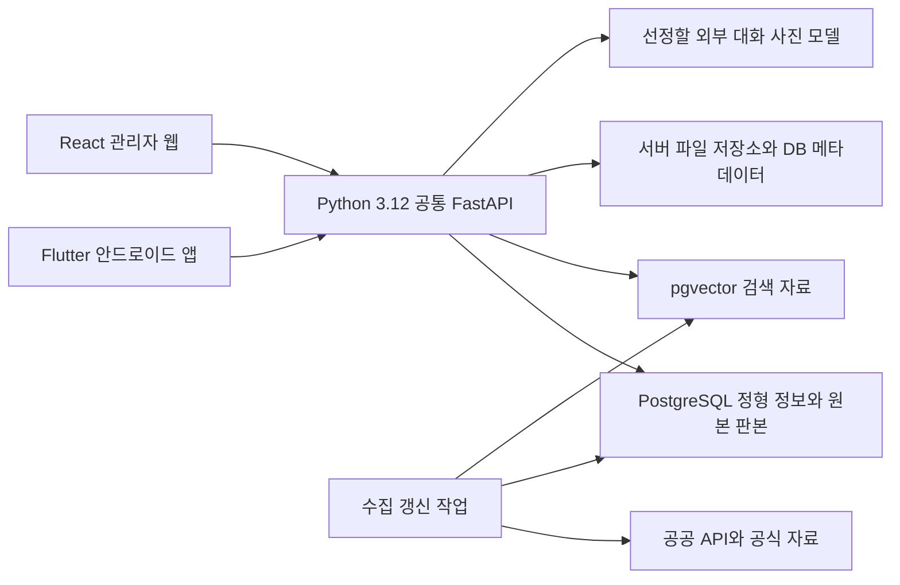

# ValueFlow AgeTech 서비스 최종 기획서

| 항목 | 내용 |
| --- | --- |
| 기준일·판본 | 2026년 11월 6일 · v2.2(검증 보고서·Asana 역산 일정·기관 BM 반영) |
| 과제 | AgeTech 기반 고령자 식생활·생활 지원 통합 앱서비스 개발 |
| 팀·서비스 | ValueFlow · 오늘동행 |
| 개발 기준 | Flutter·안드로이드 / React 관리자 웹 / Python 3.12 공통 FastAPI·별도 worker / PostgreSQL+pgvector |
| 실행 일정 | 11/10 기반 준비, 12/05 실제 통합, 12/13 발표본 고정, 12/16 최종 발표. 별도 제출일 확인 필요 |
| 저장소 | [GitHub SoftwareProject](https://github.com/dlwlssud123/SoftwareProject) |
| 업무 관리 | [Asana ValueFlow_SWProject](https://app.asana.com/1/1219809827264922/project/1219809211310255) |

이 기획서는 기존 수행계획, 10/29 기업 방문, 팀원 댓글 취합과 10/31 사용자 결정을 통합한 개발 기준본이다. 기존 식단·복지·사진 분석·AI의 고도화에 식단표·장보기·저장, 복지 저장·신청 도움, 본인 선택 공유, 생활 가이드, 무료급식소/경로식당 안내, 단순 달성 캐릭터 반응, ‘다음’ 음성 조리, 제철 재료 추천·쿠팡 외부 링크를 추가 개발한다. 사진 영양분석은 식사 기록을 먼저 보여주고 영양 수치는 상세로 제공한다.

**최신 결정:** 커뮤니티·하루 영상은 후속 개발로 전환한다. 캐릭터는 본인 확정 활동의 단순 달성 반응만, 음성 조리는 ‘다음’ 명령만 먼저 개발한다. 제철은 월별 재료 정보로 추천에 반영하고 구매는 쿠팡 외부 링크로 연결한다. 실시간 가격·최저가 비교·결제/배송 처리는 이번 범위에 넣지 않는다. ‘나머지 개발’은 이번 기능별 논의에서 찬성 방향이 모인 확장 기능을 뜻하며, 원 조사 65개 전체나 기존 후속 기능의 일괄 채택이 아니다.

**기술 구성:** Flutter 앱 / React 관리자 웹 / Python 3.12+FastAPI 공통 서버 / 별도 Python worker / PostgreSQL+pgvector / 서버 파일 저장소(DB는 경로·메타데이터). 개인 하루 영상과 관리자 자동 영상 제작은 모두 후속이다. 이번 범위 변경만으로 새 영상 처리 도구·서버를 도입하지 않는다. 실제 환경·외부 공급자·비용 검증은 별도다.

10/31 취합 시 기능별 댓글 38개·상위 제안 3개를 확인했으며, 같은 사람의 원댓글/보완댓글은 독립 찬성표가 아니다. 이번 범위는 사용자 결정이며 전원 합의로 표시하지 않는다. 실행 일정은 11/04 역산 계획을 11/06 Asana와 대조한 10절을 따른다. 실제 공수·완료 근거는 별도로 확인한다.

## 1. 서비스 목적과 해결할 문제

오늘동행은 독거 어르신이 식사 메뉴와 조리 방법을 찾고, 음식의 영양을 확인하며, 자신에게 관련 있는 복지·생활 정보를 쉽게 이용하도록 돕는 서비스다. 기업 제안 과제를 바탕으로 팀이 사용자 앱·백엔드·공공데이터·관리자 운영을 연결한 시제품을 개발한다.

주요 문제는 다음과 같이 설정한다.

- 식사 준비 시 메뉴·재료·조리 방법을 여러 곳에서 찾아야 한다.
- 사진 속 음식과 실제 섭취량을 확인해 영양 정보를 이해하기 어렵다.
- 복지 제도의 지역·지원 대상·신청 방법을 직접 비교해야 한다.
- 작은 글씨, 긴 입력, 복잡한 화면 이동이 이용 부담이 될 수 있다.
- 기업 방문에서는 정보 조회를 넘어 사용자가 참여하고 소통할 수 있는 기능을 보강할 필요가 제기되었다.

이 문제 설정과 기업 시연에 대한 평가는 실제 어르신 조사 결과와 구분한다. 사용자 평가를 통해 불편의 정도와 개선 효과를 확인한다.

## 2. 사용자와 이용 범위

| 사용자 | 제공할 가치·이용 상황 | 범위 |
| --- | --- | --- |
| 어르신 본인 | 식단·레시피·복지 정보를 큰 글씨와 선택형 입력으로 확인 | 현재 시제품과 기본 개발의 중심 사용자 |
| 보호자 | 어르신이 직접 보내기로 선택한 식단·장보기·안내 카드 확인 | 초기에는 외부 수동 공유. 가족 계정 연결·자동 알림·공동 편집은 후속 |
| 관리자 | 자료 갱신·품질·게시 상태, 가이드·제철/지역시설 정보 검수 | React 관리자에서 수행할 필수 운영 기능. 커뮤니티 운영은 후속 |
| 기업·지도교수·팀 | 범위·품질·일정과 통합 시연 결과 확인 | 요구사항 검토·평가·인수 |

보호자 대리 사용과 어르신의 직접 사용 중 어느 상황을 더 우선할지는 추가 확인한다. 현재 프로토타입의 주 사용자 가정을 변경하려면 화면·개인정보·일정을 함께 재검토한다.

## 3. 10월 29일 기업 방문 반영

| 피드백·제안 | 이번 기획서의 반영 | 결정 상태 |
| --- | --- | --- |
| 화면은 직관적이지만 정보 나열만으로는 기능적 차별성이 약함 | 사용자가 직접 수행하는 과제와 완료 기준을 기능별로 정의 | 기존 기능의 개선 방향에 반영 |
| 친구 찾기·전화·음성 소통 권고 | 본인 선택 공유를 먼저 개발하고 커뮤니티는 후속 | 10/31 사용자 결정. 기존 최소 커뮤니티 채택을 후속으로 변경 |
| 보호자와의 상호작용·근황 공유 중요 | 본인 선택 외부 공유를 먼저 제공 | 가족 계정·자동 알림·공동 편집은 후속 |
| 복지에 지역 인식과 지식 검색 적용 | 지역 메타데이터·전국 사업 구분·복지 RAG를 기존 개발 계획에 연결 | 기존 계획의 고도화 |
| 할루시네이션·프롬프트 인젝션·예외 처리 주의 | 근거 검증·범위 밖 질문·오류·외부 자료 처리 기준을 비기능 요구사항에 반영 | AI 개발·시험에 반영 |
| 배송은 외부 플랫폼 링크 정도로 구현 | 레시피/장보기 재료에서 쿠팡 검색·상품 외부 링크 연결 | 링크 수준 채택. 최저가·앱 내 주문/배송은 후속·보류 |
| API 비용과 BM을 함께 고려 | 사용량·비용 산정과 운영 방식 검토를 기획·평가에 포함 | 기관 구독/판매를 제1 BM으로 설정. 가격·원가·구매 수요 미검증 |
| 영상 자동화·여가 콘텐츠 강화 | 기존 콘텐츠 연결과 자동 제작을 구분. 영상 제작은 확장 후보로 관리 | 기존 조회·연결은 계획 유지, 자동 제작은 협의 대기 |

기업의 대학 공개정보 RAG 시연과 저비용 영상 제작 사례는 설계 참고 자료다. 회의록의 수집 건수·출처 수·영상 원가는 우리 서비스의 성능이나 확정 예산으로 사용하지 않는다.

## 4. 11/06 구현 기준과 예정 범위

### 4.1 현재 시제품

확인 기준은 팀의 11/06 검증 보고서와 당시 체크아웃이다. 이후의 백엔드 구현과 RAG 결정은 [백엔드 실행·검증 기록](../../src/backend/README.md)과 [임베딩 모델 결정안](../data/rag_embedding_decision.md)을 참고한다. 10/29 시제품 시험·11/05 로컬 적재 기록은 각 시점의 증거로 구분한다. 팀원 미공유 브랜치의 완료 여부는 단정하지 않는다.

| 영역 | 확인된 동작 | 남은 차이 |
| --- | --- | --- |
| 앱·접근성 | Flutter 안드로이드, 하단 5개 탭, 큰 버튼, 글자 100·120·140%, TTS, 설정 저장 | 실제 어르신 평가·서버 통신·iOS 검증은 미완료 |
| 식단 추천 | API 레시피 50건, 시간대·건강 상태 16개 조합의 고정 순서, 알레르기·식감 필터, 최대 5건 | 저장 프로필·섭취 이력 기반 개인화와 다양성 개선 예정 |
| 레시피 상세 | 재료명·분량·그룹별 표시, 제공된 전체 조리 단계, 누락 번호 안내, 한 단계씩 보기·타이머 | 원본 데이터 자체의 누락과 영양 기준량 검증 보완 필요 |
| 복지 추천 | 전국 사업 6종의 실제 원문, 나이·가구·소득 구간에 따른 안내 순서, 선정 기준·혜택·공식 링크 | 지역 사업 수집·RAG·실시간 갱신 예정. 수급 자격을 판정하지 않음 |
| 영양 분석 | 카메라·앨범 선택, 미리보기, 공개 레시피 영양 수치를 사용한 별도 예시 체험 | 선택 사진의 음식 자동 인식·분량 확인·실제 계산은 미연결 |
| AI 도우미 | 사용법 예시 대화, 읽어주기, 복지 진입, 사진 보기·외부 지도 검색 | 자유 대화·근거 검색·사진 풀이 모델은 미연결 |
| 건강쇼츠·놀이터 | 주제별 외부 영상 검색, 같은 그림 찾기 게임, 화면 내 주제 메모 | 영상 목록·재생·운영 API의 연결 고도화 예정 |
| 데이터·서버 | FastAPI 공통 응답·오류·요청 ID·health 2개, 원천 판본 모델·적재 CLI·갱신/실패 복구 기반 | 업무 조회·사용자/식사 기록 API·RAG·앱 연동·실행 가능한 React 관리자는 현재 체크아웃에서 미확인 |
| 검증 | 11/06 보고서: 데이터 222·백엔드 26·Flutter 33 시험 통과, DB 시험 10개 제외 | 전체 통합·실제 DB 재실행·실기기·외부 AI·기업 서버는 이번 보고서에서 미검증 |

입력 프로필은 현재 메모리에서만 사용하고, 글자·음성 설정만 기기에 저장한다. 외부 링크를 제외한 핵심 추천은 오프라인에서 동작한다. API 키는 수집 환경에서 관리하며 소스·공개 자료에 기재하지 않는다.

### 4.2 임시 일정에 포함한 기존 기능 고도화

식단·복지 추천을 서버와 연결하고 프로필·확정 섭취 기록, 사진 분석·공공 영양 계산, 복지·레시피 RAG, 관리자 기본 운영, 데이터 갱신·품질 검증을 개발한다. 건강쇼츠·놀이터·생활 안내는 확정된 기본 이용 흐름과 공급자 조건에 맞춰 연결한다.

현재 일정은 10절의 11/06 Asana 스냅샷을 따른다. 기반 시험 통과와 합의 기능 전체 구현·통합·인수 완료는 구분하며, 남은 업무 기능 구현과 팀원 코드 인계를 함께 산정한다.

## 5. 기능적 요구사항

### 5.1 기본 개발 요구사항

| ID | 기능 | 목표 동작·완료 기준 | 현재 상태·개발 책임 |
| --- | --- | --- | --- |
| CORE-01 | 조건별 식단 추천 | 제외 재료를 우선 적용하고, 프로필·시간대·확정 섭취 이력으로 후보·다양성·추천 이유를 연결 | 고정 규칙 시제품 구현. 이진녕·최재영, 화면 김찬형 |
| CORE-02 | 재료·조리 안내 | 제공된 재료·분량·원문 번호를 보존하고 전체 단계·읽어주기·단계별 조리를 확인 | 시제품 구현. 김찬형, 데이터 검수 최재영·김민찬 |
| CORE-03 | 사용자 식별·프로필·식사 기록 | 동의한 프로필과 사진·음식명·식사 시간·확정 분량을 사용자별로 저장·수정·삭제하고 하루 식사 돌아보기와 다음 추천에 연결 | 서버 세션·기록 저장 미구현. 이진녕·김찬형 |
| CORE-04 | 사진 기반 식사 기록·영양 확인 | 사진→음식 후보·분량 확인→식사 시간·기록 확정. 음식명·시간·쉬운 설명을 먼저 표시하고 영양 수치·기준량·출처는 상세에서 확인 | 선택·예시 화면만 구현. 사진 인식·영양 계산은 유지하며 서버 이진녕, 매핑 최재영, 화면 김찬형 |
| CORE-05 | 지역 기반 복지 안내 | 전국·지역 사업을 구분하고 나이·가구·지역 조건에 관련 있는 제도·지원 기준·공식 경로를 안내 | 전국 6종 구현. 수집 최재영, API 이진녕, 화면 김찬형 |
| CORE-06 | 근거 기반 AI·복지 도우미 | 공식 자료에서 근거를 검색하고 출처·확인 시점을 제시. 정보 부족·범위 밖·오류를 안내 | 예시 대화만 구현. API 이진녕, RAG 최재영, 화면 김찬형 |
| CORE-07 | 건강쇼츠·놀이터·생활 정보 | 주제별 영상·장소·생활 안내를 제공하고 오류·중지·외부 이동 상태를 구분 | 검색·게임 등 일부 구현. 화면 김찬형, API 이진녕·데이터 최재영 협업 |
| CORE-08 | 글자·음성·선택형 입력 | 큰 글씨·버튼·읽어주기와 명확한 입력·대기·오류 안내를 대표 과제로 검증 | 기본 설정 구현. 김찬형, 평가 김민찬 |
| CORE-09 | 관리자 기본 운영 | 데이터 갱신·품질·검토·게시·재시도와 가이드/지역시설/제철 자료 검수를 권한·감사 기록으로 연결 | 미구현. UI 김민찬, 운영 API 이진녕, 원천 필드 최재영. 신고/숨김은 커뮤니티와 함께 후속 |
| CORE-10 | 공공데이터 갱신·판본 관리 | 원문·출처·기준량·확인 시각을 보존하고 실패 시 마지막 정상 자료를 유지. 원문과 검색 판본을 함께 갱신 | 갱신 CLI·판본·실패 복구 기반 구현. DB/검색 게시·앱 전파는 미검증. 최재영·이진녕, 검토 김민찬 |

식단은 의학적 처방, 복지 안내는 수급 자격 판정을 제공하는 기능으로 정의하지 않는다. 사진 인식 결과도 사용자 확인과 검증된 식품 데이터 연결을 거쳐 활용한다.

### 5.2 채택한 기능과 최소 완료 기준

| ID | 기능·구분 | 최소 범위·완료 기준 | UI 위치·경계 |
| --- | --- | --- | --- |
| ADD-01 | 하루 식단표·장보기·레시피 저장 / 식단 확장 | 아침·점심·저녁의 하루 계획, 원하는 끼니만 교체, 선택 간식·특별한 날 메뉴, 날짜별 저장/수정/삭제·레시피 즐겨찾기, 계획 메뉴의 재료 목록·구매 체크 | 식단추천 홈의 ‘내 식단’과 레시피 상세 ‘식단표에 담기/저장/장보기’. 건강·제외 조건은 끼니 교체에도 유지. 자동 인분 계산은 후속 |
| ADD-02 | 관심 복지·신청 도움 / 복지 확장 | 관심 저장/해제, 지원 기준·준비사항·공식 신청/문의처·출처 확인일을 모은 안내 카드, 본인이 적는 진행 메모 | 복지 결과/저장 목록의 ‘신청 준비·상담용 안내’. 주민센터에 보여줄 수 있도록 큰 글씨로 표시. 모르는 준비물·기간은 확인 필요. 대리 접수·공식 심사 상태 자동 조회 제외 |
| ADD-03 | 본인 선택 외부 공유 / 공통 확장 | 레시피·식단표·장보기·복지 안내 카드에서 공유할 항목 선택→내용 확인→Android 공유 화면. 취소·실패·개인정보 제외 확인 | 각 결과의 ‘가족에게 보내기/공유’. 대상은 사용자가 선택. 자동 가족 전송·자체 메신저 제외 |
| ADD-04 | 식단 커뮤니티 / 후속 | 10/31 사용자 결정으로 후속 개발 전환. 사진·후기·댓글·신고/차단·관리자 숨김은 함께 후속 검토 | 이번 앱에 ‘우리 밥상’ 버튼·작성/운영 API를 먼저 추가하지 않음 |
| ADD-05 | 생활 이용 가이드 / 생활 도우미 확장 | 검수한 큰 글씨·그림·단계별 가이드, 주제/어려운 부분 제안 접수, 관리자의 확인·보완·게시. 최소 1개 완결된 가이드로 요청→검수→조회 확인 | AI 도우미 ‘생활 도우미’→가이드 목록/단계. 스마트폰 사용·지역 콜택시 이용 등 주제. 현재 사용법 예시 채팅과 구분하며 지역/문의 정보는 확인 후 게시 |
| ADD-06 | 무료급식소·경로식당 안내 / 식단·복지 확장 | 공식 자료의 시범 지역 시설명·주소·대상·시간/요일·문의처·기준일 안내. 위치 허용 시 가까운 순, 거부 시 지역 선택. 자료 누락/휴무 가능성과 문의 경로 표시 | 식단추천 홈 ‘오늘 밥하기 힘들어요’→시설 목록/지도 연결. 시설이 가깝다는 이유로 이용 자격·당일 운영을 확정하지 않음 |
| ADD-07 | 단순 달성 캐릭터 반응 / 공통 보완 | 본인이 확정한 활동 완료에 정지 이미지/짧은 칭찬 반응, 같은 완료의 중복 반응 제어·완료 취소 시 상태 반영, 설정에서 끄기 | 기록 완료 화면·홈의 방해하지 않는 위치. 성장·꾸미기·포인트/아이템·커뮤니티 프로필 연계 제외. 일반 인사/터치 놀이는 필수 범위 아님 |
| ADD-08 | ‘다음’ 음성 조리 / 조리 확장 | 조리 화면에서 켜기/끄기, TTS 종료 후 ‘다음’ 인식→한 단계 이동. 중복 인식·마지막 단계·실패 처리, 권한 거부/미지원 시 기존 버튼 유지 | 기존 ‘한 단계씩 따라 만들기’. 첫 음성 명령은 ‘다음’만. 이전/타이머/중지 명령·상시 청취는 후속 |
| ADD-09 | 제철 재료 추천·쿠팡 링크 / 식단·장보기 확장 | 출처·적용 월을 검수한 제철 재료와 실제 레시피 재료 연결→기존 건강/알레르기 필터 뒤 추천에 반영·추천 이유 표시. 재료명 기반 쿠팡 검색 또는 검토한 상품 외부 링크 | 식단/레시피의 ‘제철 재료’ 표시, 재료·장보기의 ‘쿠팡에서 재료 찾기’. 가격/재고/규격/배송비는 외부 페이지 확인. ‘오늘 저렴/최저가’ 표현 금지 |

사진 식사 기록 중심의 개선은 CORE-03·04에 포함한다. 열람만으로 식사 완료를 추정하지 않고 본인이 확인한 음식·식사 시간을 먼저 보여주며, 칼로리·탄수화물·단백질·지방 등 계산 결과는 상세로 유지한다. ‘하루 식단’은 검토한 조건별 메뉴 계획이며 의학적으로 균형 잡힌 처방을 보장하지 않는다.

### 5.3 최소 구현과 데이터 검증 기준

이번 채택 항목은 기능 범위가 정해진 것이며 구현·시험 완료가 아니다. 음성 인식의 실제 Android 지원·한국어/읽어주기 충돌, 급식시설 데이터의 지역/최신성, 제철 목록의 출처·월·재료 매핑, 쿠팡 링크 이동/실패·검색어를 검증한다. 제철을 가격 저렴함으로 해석하지 않는다.

캐릭터는 단순 달성 반응만 개발하고 성장/꾸미기를 별도 조건부 필수 기능으로 남기지 않는다. 하루 영상·커뮤니티는 후속으로 확정한다. 새 기능이 기존 제외 조건·개인정보·기본 버튼 이용을 방해하지 않아야 한다.

### 5.4 후속·보류 범위

- 생활 캘린더·복약·물/운동/외출 루틴, 보호자 계정 연결·복약 누락 자동 알림은 핵심 기능 안정화 이후 검토한다.
- 자유 음성 일지·자동 전사·추억 질문·가족 공동 편집·냉장고 재고·자동 인분 계산은 후속이다. 이번 식사 기록과 구분한다.
- 복지 기간 자동 알림은 공식 기간 데이터·변경/종료 조건 확인 후 검토한다. 초기에는 확인된 기간과 공식 문의 경로를 안내한다.
- 대본·음성·자막을 만드는 관리자용 영상 자동 제작은 후속 후보다. 개인 하루 영상은 이 서버 제작 플랫폼의 채택을 전제로 하지 않는다.
- 추천 만족도·선호 피드백과 직접 주문/배송·가격 비교는 후속·보류다. 기존 Asana 배송 작업에는 과거 범위가 남아 있으므로 다음 작업 정비 때 쿠팡 링크 채택 부분과 분리한다. 외부 링크만 이번 ADD-09에 포함한다.
- 커뮤니티·하루 영상은 10/31 사용자 결정으로 후속 개발한다. 신고/차단/숨김·영상 합성도 함께 후속이다.
- 친구 찾기·만남·DM·자체 통화, 감시·자동 출동·검사·전용 장비, 재원 없는 현금/물품 보상은 이번 범위에서 제외한다.

### 5.5 최종 화면 연결

| 화면 | 확정한 사용자 흐름 | 조건부·후속 경계 |
| --- | --- | --- |
| 식단추천 | 기존 추천·내 식단/장보기/저장, 제철 재료 표시, ‘오늘 밥하기 힘들어요’ 지역시설 진입 | 커뮤니티·하루 영상 진입 없음. 단순 달성 캐릭터는 콘텐츠/버튼을 가리지 않는 위치 |
| 레시피·조리 | 재료/장보기의 쿠팡 링크, 기존 단계별 조리의 ‘음성으로 다음’ 켜기/끄기 | 음성 실패 시 버튼 유지. 타이머는 기존 버튼만 사용 |
| 기존 영양분석 | 음식/분량·식사 시간 확인→기록→하루 식사 돌아보기, 영양 상세·완료 반응 | 화면 문구는 식사 기록 우선. 영상 촬영·합성은 후속 |
| AI 도우미 | 복지·사진·장소·대화, 생활 가이드 | 지역 식사 지원·관심 복지는 동일 상세/데이터 재사용 |
| 건강쇼츠·놀이터 | 기존 주제·놀이 고도화 | 성장/꾸미기·새 다인 게임은 추가하지 않음 |
| React 관리자 | 기존 자료/품질/게시, 가이드·제철/시설 자료 검수 | 커뮤니티 신고/숨김·제작 스튜디오는 후속 |

하단 5개 영역은 유지하고 두 번째 영역의 목적은 식사 기록·영양 확인으로 명확히 한다. 가족 공유는 본인 선택 외부 공유이며 자동 전송이 아니다.

### 5.6 결정 근거와 변경 관리

| 근거 | 반영 |
| --- | --- |
| 조의현의 10/30 Asana 댓글 | 복지 저장·신청 도움, 식단표/장보기/저장, 본인 공유 우선. 캘린더/복약·보호자 연결 후속. 커뮤니티 운영 부담과 음성 전사 우려 기록 |
| 김민찬의 10/30 Asana 댓글 | 식단 커뮤니티, 기록 우선 영양 UI, 하루 끼니별 교체·간식/특별한 날 메뉴, 생활 가이드, 캐릭터·개인 하루 영상 제안 반영 |
| 10/31 사용자 결정 | 커뮤니티·하루 영상 후속, 캐릭터 단순 달성 반응, 음성 ‘다음’ 우선, 제철 재료 추천·쿠팡 링크. 그 밖의 찬성 방향 확장 개발 |

팀원 제안은 전원 합의로 표시하지 않는다. 10/30 최소 커뮤니티 채택·캐릭터/영상 조건부 검토보다 10/31 후속 결정이 우선한다. 새 제안은 가치·중복·화면/API/DB·권한·비용·공수·일정 영향을 확인한 뒤 채택/조건부/후속/보류를 구분해 이 문서와 작업 기록을 갱신한다.

## 6. 비기능적 요구사항

기업 방문 보고서의 NFR-01~NFR-09를 아래 기준과 연결한다. 수치 목표는 11절에서 별도로 구분한다.

| 항목 | 개발·검증 기준 | 관련 보고서 |
| --- | --- | --- |
| 접근성·사용성 | 글자 확대·화면 읽기·버튼 구분·입력 단계·오류 복구를 대표 과제로 확인. 실제 어르신 평가 기록 | NFR-01 |
| 개인정보·소유권 | 동의 목적과 사용자별 조회·수정·삭제 범위를 구현. 개인 사진·기록·인증 정보를 공개 자료와 분리 | NFR-02. 보호자 공유 정책 NFR-03은 추가 기능 채택 시 확정 |
| AI 근거·예외 처리 | 검색 근거와 답변의 수치·조건·출처를 대조. 부족한 근거와 범위 밖 질문은 확인 불가·추가 질문으로 처리 | NFR-04·NFR-06 |
| 인젝션 대응 | 검색 문서·사용자 입력을 자료로 처리하고 역할·권한·도구 호출 지시와 구분. 공격성 입력을 회귀 시험 | NFR-05 |
| 운영 효율 | 호출량·토큰·실패·시간·영상 생성 비용을 구분해 기록. 공개 자료 캐시·중복 요청·근거 선별 방안을 비교 | NFR-07 |
| 운영·BM 검토 | 기능당 원가와 이용량을 산정하고 기관 납품·라이선스 등 운영 방식을 비교. 예산·수익 모델은 별도 합의 | NFR-08 |
| 범위·변경 관리 | 기존 기능 완료 기준과 추가 후보를 구분. 기능 채택 시 화면·데이터·권한·담당·일정을 함께 갱신 | NFR-09 |
| 안정성·재현성 | 원문·판본·코드·평가 표본을 연결하고, 갱신 실패·재시작·중복 확정·복구를 시험 | 기존 수행·구현계획의 운영 기준 |

## 7. 대표 이용 시나리오

### 7.1 현재 가능한 시연

1. 식생활 서비스에서 가상 사용자 정보를 입력한다.
2. 식사 시간·건강 상태·제외 재료를 선택하고 추천 결과를 확인한다.
3. 재료와 제공된 전체 조리 방법을 읽거나 한 단계씩 따라 만든다.
4. 복지 추천에서 가구·소득 구간을 입력하고 관련 전국 사업의 기준·혜택·공식 경로를 확인한다.

### 7.2 기존 기능 고도화의 목표 흐름

- **식사 준비:** 저장 프로필 확인 → 하루 메뉴 추천 → 원하는 끼니 교체/저장 → 장보기 체크 → 조리
- **식사 기록·영양:** 사진 선택 → 음식·분량・식사 시간 확인 → 실제 섭취 확정 → 하루 식사 돌아보기. 필요한 경우 영양 상세·출처/기준량 확인
- **복지:** 지역·상황 선택 → 관련 제도/질문 → 관심 저장 → 지원 기준·준비사항·문의처 안내 카드 → 공식 신청/문의
- **조리·구매:** 제철 재료를 반영한 추천 → 재료/장보기 → 쿠팡 외부 링크, 조리 화면에서는 음성 ‘다음’으로 단계 이동
- **식사 지원:** 오늘 밥하기 힘들어요 → 위치 허용 또는 지역 선택 → 시설 운영/대상/문의처 확인
- **생활 가이드:** 생활 도우미 → 주제 → 큰 글씨/그림 단계 안내 → 어려운 부분/주제 제안 → 관리자 검수 후 보완
- **가족 수동 공유:** 공유할 식단표·재료 목록·안내 카드 선택 → 내용 확인 → 시스템 공유 화면에서 대상 선택
- **운영:** 원문 수집 → 품질·변경 검토 → 원문·검색 판본 게시 → 앱 조회·근거 답변 → 실패·비용 점검

캐릭터는 확정 활동의 단순 완료 반응이다. 커뮤니티·하루 영상·보호자 자동 연결·직접 배송·관리자 자동 제작은 후속이다.

## 8. 시스템·데이터 구성

### 8.1 현재 구조

```text
식품안전나라·복지로 API
        ↓ Python 수집 스크립트
공개 JSON·이미지·출처 및 수집 시각
        ↓ 앱에 포함
Flutter 안드로이드 앱의 고정 규칙 추천
```

### 8.2 예정 구조



서버·DB의 공통 기반과 원천 적재는 존재하지만 업무 API·RAG·관리자·앱 통합 완료를 뜻하지 않는다. 앱은 이미 선택한 Flutter를 유지하고, iOS는 이번 안드로이드 중심 검증 이후의 별도 범위다. 모델·영상·지도 공급자는 기능·이용 조건·표본 품질·운영 비용을 확인해 선정한다.

| 데이터 | 현재 확보·처리 | 예정 활용 |
| --- | --- | --- |
| 레시피 | 앱 번들 50건과 별도로 11/05 로컬 원천 1,156건 적재 기록. [적재 범위](../data/public_db_import.md) | 결측·단위 검증, 다양성·개인화·원문 검색 |
| 복지 | 앱은 전국 6종. 11/05 로컬 목록 461·상세 80·대기 381건 [적재 기록](../data/welfare_db_import.md). 신청 가능 여부 미확인 | 지자체 자료·지역 필터·주기 갱신·복지 RAG |
| 식품영양 DB | 품목대표 8,807건 로컬 적재 기록. 재료 매핑·계산 결과·앱 연결은 별도 미완료 | 사용자 확인 분량의 영양 계산 |
| 프로필·섭취 | 프로필은 메모리에서 일회성 사용. 섭취 기록 저장 미구현 | 동의한 사용자 정보·확정 이력·개인화 |
| 문서·검색 | RAG 원문·청크·벡터 저장 미구현 | 출처·판본·지역·게시 상태가 연결된 검색 |
| 콘텐츠·운영 | 외부 검색·게임과 API 수집 스크립트 | 검토한 영상·운영 집계·관리자 화면 |

API의 비어 있는 조리 단계나 미확인 분량을 임의로 채우지 않는다. 수집 결과와 가공 상태를 보존하고, 추천·계산에 사용할 수 있는 범위를 검수한다.

## 9. 팀 역할과 협업

| 책임자 | 주 담당 | 협업·인계 |
| --- | --- | --- |
| 이진녕 | 기술 총괄, 공통 API·DB·인증·추천·기록·영양·AI·가이드/시설 운영·배포 | 앱·관리자 계약과 채택 기능의 서버 공수·선행 관계 조율 |
| 김찬형 | Flutter 앱·하루 식단/기록·공유·음성 조리·가이드·접근성·시연 | 단순 캐릭터·음성 조리의 기기 동작 확인. API·필드·단위 협업 |
| 최재영 | 수집·전처리·식품 매핑·갱신·RAG 청크·벡터 인덱스 | 원문·품질 상태를 API·평가·관리자 담당에게 전달 |
| 김민찬 | React 관리자 UI·가이드/제철/시설 검수 화면, 자료·모델/기능 평가·시각화·문서 | 운영 API는 이진녕, 원천·가이드 출처는 최재영과 협업 |
| 조의현 | 요구사항·범위·일정·기업 및 교수 협의·산출물 검수·발표 | 기능 채택·변경 사항과 팀 합의를 기록 |

새 기능은 사용자 시나리오, 화면·서버·데이터 역할, 이용 조건, 개인정보, 비용과 완료 기준을 확인한 뒤 작업으로 분할한다. 작업 책임자와 협업자를 구분하고 주간 회의에서 진행·오류·다음 작업을 점검한다.

## 10. 임시 일정과 업무 관리

2026-11-06 Asana 재조회 기준으로 **11/10 개발 기반·API 계약·DB 준비 → 12/05 확정 기능 구현·실제 통합 → 12/13 발표본·자료 고정 → 12/16 최종 발표**를 따른다. 12/06~15는 사용성·회귀 시험, 오류 수정과 발표 준비에 사용한다. 12/16은 발표일이며 별도 제출일·방식은 확인이 필요하다. 기존 12/24 마무리·12/25 예비일 계획은 이전 임시안으로 대체한다.

전체 70개(완료 23개·미완료 47개)를 확인했다. 의견·문서 작업이 포함된 수치이므로 기능 완료율로 환산하지 않는다. 아래는 BM 별도 작업을 제외한 날짜 있는 상위 작업의 조회 스냅샷이다. 날짜와 담당은 계획이며 실제 완료·공수 보장을 뜻하지 않는다.

| 작업 | 책임·협업 | 시작 | 마감 |
| --- | --- | --- | --- |
| [추가 기능 의견 취합 (10/30 마감)](https://app.asana.com/1/1219809827264922/project/1219809211310255/task/1220001346892019) | 조의현 | 10/29 | 10/30 |
| [데이터·AI·RAG 개발 도구와 저장·인계 규격 확정](https://app.asana.com/1/1219809827264922/project/1219809211310255/task/1220020267617878) | 최재영 | 10/29 | 10/30 |
| [백엔드·DB 프레임워크와 공통 개발환경 확정](https://app.asana.com/1/1219809827264922/project/1219809211310255/task/1220030085268209) | 이진녕 | 10/29 | 10/30 |
| [확정 범위·개발환경·12/16 역산 일정 착수 확인](https://app.asana.com/1/1219809827264922/project/1219809211310255/task/1219998746777888) | 조의현 | 11/04 | 11/04 |
| [관리자 웹 프레임워크·UI·평가 환경 확정](https://app.asana.com/1/1219809827264922/project/1219809211310255/task/1220020268272792) | 김민찬 | 11/04 | 11/04 |
| [Flutter 앱 프레임워크·상태관리·통신 구성 확정](https://app.asana.com/1/1219809827264922/project/1219809211310255/task/1220020311820348) | 김찬형 | 11/04 | 11/04 |
| [Python 백엔드 기반과 공통 API 계약 구현](https://app.asana.com/1/1219809827264922/project/1219809211310255/task/1219998746997705) | 이진녕 | 11/05 | 11/07 |
| [레시피 조리 단계 누락과 재료 데이터 품질 검증 보완](https://app.asana.com/1/1219809827264922/project/1219809211310255/task/1219999044369646) | 최재영 | 11/05 | 11/07 |
| [관리자 웹 프로젝트 초기 설정·공통 화면 기반 개발](https://app.asana.com/1/1219809827264922/project/1219809211310255/task/1220030085939939) | 김민찬 | 11/05 | 11/07 |
| [Flutter 서버 연동 구조·API DTO·화면 상태 기반 개발](https://app.asana.com/1/1219809827264922/project/1219809211310255/task/1220036097251626) | 김찬형 | 11/05 | 11/07 |
| [API 인계·추가 기능 공수·외부 제공자·사용성 섭외 계획 확인](https://app.asana.com/1/1219809827264922/project/1219809211310255/task/1220193233163720) | 조의현 | 11/05 | 11/07 |
| [확정 범위·기술 계약·역산 일정 문서 정합성 확인](https://app.asana.com/1/1219809827264922/project/1219809211310255/task/1219998877457836) | 김민찬 | 11/05 | 11/08 |
| [레시피·복지·사용자 데이터 저장 구조 구현](https://app.asana.com/1/1219809827264922/project/1219809211310255/task/1219998934126684) | 이진녕 | 11/08 | 11/10 |
| [생활 가이드·달성 규칙·공유/복지 안내 문구 준비](https://app.asana.com/1/1219809827264922/project/1219809211310255/task/1220193275966059) | 조의현 | 11/09 | 11/14 |
| [관리자 웹 UI와 수집·콘텐츠·품질 검토 화면 구현](https://app.asana.com/1/1219809827264922/project/1219809211310255/task/1219999048287403) | 김민찬 | 11/09 | 11/28 |
| [[마일스톤] 11/10 개발 기반·API 계약·DB 준비 완료](https://app.asana.com/1/1219809827264922/project/1219809211310255/task/1220193233034383) | 조의현 | — | 11/10 |
| [사용자 프로필·세션·동의 처리 구현](https://app.asana.com/1/1219809827264922/project/1219809211310255/task/1219998877627633) | 이진녕 | 11/11 | 11/13 |
| [공공 영양 DB 적재와 음식명·식품 코드·단위 매핑](https://app.asana.com/1/1219809827264922/project/1219809211310255/task/1219999045972827) | 최재영 | 11/11 | 11/14 |
| [Flutter API 클라이언트와 식단·복지 서버 연동](https://app.asana.com/1/1219809827264922/project/1219809211310255/task/1219999048287339) | 김찬형 | 11/11 | 11/14 |
| [식단 개인화·메뉴 다양성과 추천 근거 개선](https://app.asana.com/1/1219809827264922/project/1219809211310255/task/1219998813167814) | 이진녕 | 11/14 | 11/17 |
| [지자체 복지 데이터 확보와 지역별 안내 확장](https://app.asana.com/1/1219809827264922/project/1219809211310255/task/1219999044472422) | 최재영 | 11/15 | 11/17 |
| [하루 식단표·장보기·레시피/복지 저장·신청 도움·공유·쿠팡 링크](https://app.asana.com/1/1219809827264922/project/1219809211310255/task/1220193276029056) | 김찬형 | 11/15 | 11/22 |
| [제철 재료·무료급식소/경로식당 자료 확보·검수](https://app.asana.com/1/1219809827264922/project/1219809211310255/task/1220193279461844) | 최재영 | 11/18 | 11/20 |
| [식단표·저장·복지 신청 도움·가이드/시설/제철 API 구현](https://app.asana.com/1/1219809827264922/project/1219809211310255/task/1220193205542713) | 이진녕 | 11/18 | 11/21 |
| [공공데이터 자동 갱신과 실패 시 캐시 유지 구현](https://app.asana.com/1/1219809827264922/project/1219809211310255/task/1219998877844868) | 최재영 | 11/21 | 11/23 |
| [사진 분석·영양 계산·섭취 확정 백엔드 구현](https://app.asana.com/1/1219809827264922/project/1219809211310255/task/1219998934146125) | 이진녕 | 11/22 | 11/27 |
| [식사 기록 중심 UI·사진 분석·분량 수정·섭취 확정 연결](https://app.asana.com/1/1219809827264922/project/1219809211310255/task/1219998935438934) | 김찬형 | 11/23 | 11/28 |
| [복지·레시피 RAG 청킹과 벡터 인덱스 구축](https://app.asana.com/1/1219809827264922/project/1219809211310255/task/1219999046170740) | 최재영 | 11/24 | 11/27 |
| [AI 도우미와 복지 RAG 답변 API 구현](https://app.asana.com/1/1219809827264922/project/1219809211310255/task/1219998813330425) | 이진녕 | 11/28 | 12/01 |
| [‘다음’ 음성 조리·단순 달성 캐릭터 반응 구현](https://app.asana.com/1/1219809827264922/project/1219809211310255/task/1220193279843104) | 김찬형 | 11/29 | 12/01 |
| [도우미·건강쇼츠·놀이터의 영상·장소·사진 풀이 연결](https://app.asana.com/1/1219809827264922/project/1219809211310255/task/1219999045973089) | 김찬형 | 12/02 | 12/03 |
| [서버 배포·복구와 앱 통합 검증](https://app.asana.com/1/1219809827264922/project/1219809211310255/task/1219998877543743) | 이진녕 | 12/02 | 12/05 |
| [[마일스톤] 12/05 확정 기능 구현·실제 통합 완료](https://app.asana.com/1/1219809827264922/project/1219809211310255/task/1220193279812032) | 조의현 | — | 12/05 |
| [실제 어르신 대상 사용성 검증과 접근성 개선](https://app.asana.com/1/1219809827264922/project/1219809211310255/task/1219998933777234) | 김찬형 | 12/06 | 12/08 |
| [데이터 품질·추천·RAG·영양 평가와 시각화 보고서 작성](https://app.asana.com/1/1219809827264922/project/1219809211310255/task/1219999197901207) | 김민찬 | 12/06 | 12/09 |
| [통합 회귀 시험·서버/데이터 오류 수정](https://app.asana.com/1/1219809827264922/project/1219809211310255/task/1220193233089279) | 이진녕 | 12/06 | 12/10 |
| [최종 발표 PPT·6분 대본·질의응답 준비](https://app.asana.com/1/1219809827264922/project/1219809211310255/task/1220208594106205) | 조의현 | 12/06 | 12/11 |
| [사용성·통합 시험에서 발견한 앱 오류 수정](https://app.asana.com/1/1219809827264922/project/1219809211310255/task/1220193279727974) | 김찬형 | 12/09 | 12/10 |
| [최종 보고서·실행 안내·구현/검증 근거 정리](https://app.asana.com/1/1219809827264922/project/1219809211310255/task/1220193205182305) | 김민찬 | 12/10 | 12/12 |
| [여유 범위의 소규모 기능 보완·마지막 회귀 확인](https://app.asana.com/1/1219809827264922/project/1219809211310255/task/1220193304910428) | 김찬형 | 12/11 | 12/12 |
| [[마일스톤] 12/13 발표용 버전·자료 고정](https://app.asana.com/1/1219809827264922/project/1219809211310255/task/1220193275811935) | 조의현 | — | 12/13 |
| [발표용 APK·시연 영상·오프라인 대비 자료 확정](https://app.asana.com/1/1219809827264922/project/1219809211310255/task/1220193304734230) | 김찬형 | 12/13 | 12/13 |
| [팀 전체 최종 리허설·6분 시간 점검·질의응답](https://app.asana.com/1/1219809827264922/project/1219809211310255/task/1220193275805020) | 조의현 | 12/14 | 12/15 |
| [[마일스톤] 12/16 최종 발표](https://app.asana.com/1/1219809827264922/project/1219809211310255/task/1220193276161554) | 조의현 | — | 12/16 |

선행조건과 인계 기준:
- 11/10 기반 준비까지 공통 DTO·ID·단위·판본·오류 응답과 DB 준비 근거를 맞춘다. 앱·관리자 기반 작업은 계약 표본으로 진행할 수 있으나 실제 서버 연결 완료와 구분한다.
- 프로필·기록은 사용자 식별·동의·소유권·중복 방지와 함께 저장→재시작→재조회→수정/삭제로 확인한다. 사진·AI 연결과 업무 기능 구현도 남아 있어 단순 연결 작업으로 축소하지 않는다.
- 수집·원천 적재와 앱 공개는 별개다. 검수→DB/검색 활성 판본→앱 조회를 연결하고 게시·임베딩 실패 시 마지막 정상 자료 유지 근거를 남긴다.
- 12/05에는 CORE-01~10, ADD-01~03·05~09와 식사 기록 UI의 실제 구현·통합 근거를 확보한다. 12/06~08 사용성, 12/06~09 평가, 12/06~10 서버 회귀·12/09~10 앱 수정 결과를 인계하고 12/13 발표본을 고정한다.
- 앱 확장(11/15~22)과 관련 API(11/18~21)는 기간이 겹친다. 계약 기반 개발과 실제 통합 시점을 구분하고 팀원 브랜치·공수·실행 결과를 확인한다. 일정 차질은 관련 담당자와 조의현이 공유한다.

**후속·보류:** 커뮤니티·하루 영상·보호자 자동 연결·성장/꾸미기·직접 주문/배송·최저가 수집·선호 학습은 기존 결정을 유지한다. 일정 갱신만으로 범위를 추가·삭제하지 않는다.

**BM 별도 관리:** [BM 모델 구축](https://app.asana.com/1/1219809827264922/project/1219809211310255/task/1220232681242897)의 기존 마감은 11/06이며 기관 고객·상품 범위·원가/과금·실증 후속 4개는 담당·기한 미지정이다. 방향 확정과 후속 사업화 검증의 완료 범위·일정을 팀·기업과 협의한다. 결제·기관 계정·대상자 관리 기능을 발표 필수 범위로 자동 편입하지 않는다.

## 11. 평가와 완료 기준

### 11.1 필수 산출물

- 안드로이드 앱과 서버·데이터·관리자를 연결한 합의 범위의 통합 시제품
- API 계약·데이터 사전·수집 및 갱신·배포·복구 안내
- 데이터 품질·영양 특성·추천 기준과 적용 예시
- 사진 인식·분량 확인·영양 계산, RAG 검색·근거 답변의 평가 결과
- 실제 어르신 사용성 평가 기록 또는 평가가 불가능한 경우의 미검증 범위 명시
- 대표 이용 흐름의 시연·최종 보고서와 운영 비용 검토
- 하루 식단의 끼니별 교체·저장/장보기, 복지 안내 카드·본인 공유의 실제 인수 결과
- 생활 가이드·급식시설·제철 안내·쿠팡 링크의 동작/자료 검증 증거
- 단순 달성 반응·음성 ‘다음’의 실제 기기/오류/대체 조작 검증 결과

### 11.2 초기 정량 목표

다음은 기존 수행계획의 평가 초안이며 측정된 성능이 아니다. 표본·환경·최종 범위에 따라 평가 전에 확정한다.

| 대상 | 초기 목표·측정 방법 |
| --- | --- |
| RAG 검색 | 정답 근거를 지정한 질문 30개 이상에서 Hit@5 80% 이상 목표 |
| 근거 답변 | 출처 포함률 100% 목표. 실제 내용·수치·조건의 일치 여부는 별도 검수 |
| DB·캐시 조회 | 고정 환경, 동시 10개·총 100회 요청에서 p95 1초 이내 목표. AI 시간은 별도 기록 |
| 토큰 효율 | 같은 질문·표본에서 평균 입력 토큰 30% 절감의 초기 비교 목표와 품질 유지 확인 |
| 추천 | 제외 조건 위반·메뉴 반복·다양성·추천 이유의 일치 비교 |
| 영양 | 식품 코드·기준량·분량·단위 환산·결측·수정 후 재계산 검증 |
| 사용자 과제 | 완료 여부·소요 시간·입력 단계·오류 복구와 불편 기록. 만족도 수치는 측정 후 보고 |

### 11.3 채택 기능의 인수 확인

| 대상 | 실제 구현 후 확인할 것 |
| --- | --- |
| 하루 식단·저장·장보기 | 끼니 하나만 교체, 다른 끼니 유지, 제외 조건 유지, 저장/해제/삭제, 불명확한 단위의 원문 보존 |
| 식사 기록·영양 | 음식명·시간·본인 확정이 먼저 보이고 영양 상세가 연결됨. 예시/실제 분석 구분, 중복 기록·수정/삭제 |
| 복지·수동 공유 | 출처·확인일·미확인 필드 표시, 공식 경로·본인 메모 구분, 공유 전 내용 확인·취소·비공개 정보 제외 |
| 제철·쿠팡 | 출처/월·레시피 재료 매핑, 제외 조건 우선, 확인한 외부 링크·실패 복구. 최저가·가격 수치 표시 없음 |
| 생활 가이드 | 단계 순서·큰 글씨·그림 설명, 주제 요청·관리자 검수·게시, 확인하지 않은 지역 문의 정보 배제 |
| 달성·음성·시설 | 본인 확정/취소·중복 반응, 다음 명령 한 단계 이동·TTS 충돌·권한 거부/버튼 대안, 시설 대상/시간/문의·위치 거부 대안 |

### 검증 근거와 남은 인수 항목

팀 검증 보고서의 11/06 실행 기록은 데이터 **222 passed**, 백엔드 **26 passed·10 skipped·1 warning**, Flutter **33 passed**다. 실제 PostgreSQL 시험은 제외됐고 health DB 시험은 모의 세션을 사용했다. 과거 로컬 적재 기록과 이번 재실행을 구분한다. 전체 통합·실기기·기업 서버·외부 AI 품질/비용·기관 구매 검증은 미입증이다. 이번 문서 수정에서 제품 시험을 재실행한 결과는 아니다.

| 보고서 항목 | 남은 구현·검수 | 책임·협업 / 완료 증거 |
| --- | --- | --- |
| F-02·04 업무 API·개인 기록·관리자 | 팀원 브랜치 취합, 공개 조회·프로필·기록·권한·관리자 검수/게시 연결 | 이진녕·김찬형·김민찬, 조의현 취합 / 앱→API→DB→재조회·수정/삭제와 운영 화면 실행 |
| F-03 실제 사진·AI | 실제 호출, 음식·분량 수정, 근거 답변·실패 복구·확정 저장 | 이진녕·최재영·김찬형 / 표본·요청/응답·출처·오류 시험 |
| F-05 갱신 전파 | 수집→검수→DB/검색 게시→앱 조회, 실패 시 정상본 유지 | 최재영·이진녕·김민찬·김찬형 / 판본 전후·실패 주입 실행 기록 |
| F-06 영양 해석 | 50개 매핑 표본과 전체 1,156개 원천 적재를 구분, 식품·상태·분량 검수 | 최재영·김민찬 / 부분 합계·근사 환산·미확인 표시와 정답 표본 |
| F-07 접근성 | 시스템 글자 배율·앱 설정·TalkBack·터치·대비 실제 기기 검증 | 김찬형·김민찬 / 현재 자체 배율 1~1.4가 시스템 배율을 보존한다고 주장하지 않음 |
| F-08 배포 | 원격 workflow·이미지·기업 서버·마이그레이션·readiness·복구 확인 | 이진녕·관련 담당 / 실행 커밋·배포·복구 기록. 로컬 구성만으로 운영 완료 판정 금지 |

기존 Hit@5·출처 포함률·응답 시간·토큰 절감 수치는 측정 성과가 아닌 평가 목표다. 사용자 효과와 기관 구매 의향도 별도 검증한다. 보고서의 개발·검증 순서 D5 A/B/C는 미결정이며 이 문서 갱신으로 선택하거나 기능 범위를 변경하지 않는다.

## 12. 비용·운영·사업성 검토

MVP의 제1 BM은 **기관·복지시설 대상 구독/판매**다. 어르신은 실제 이용자, 기관은 도입·비용 지불 고객이다. 기관의 정보 안내·교육·자료 관리 부담을 줄인다는 가설을 검증한다. 이는 방향 결정이며 도입 의향·가격·계약·매출이 검증됐다는 뜻은 아니다.

[BM 의견 취합](https://app.asana.com/1/1219809827264922/project/1219809211310255/task/1220231833772282)과 후속 4개 작업을 근거로 고객/구매 절차·상품 범위·원가/과금·실증 계획을 정리한다. 구독(기본료+이용 인원 구간)과 판매/라이선스+유지관리 조건을 비교한다. 개인 구독·제휴·광고는 후속 후보이며 제휴 수익을 확정하지 않는다. 기관 계정·결제·자동 알림은 추가 개발 합의 전 필수 범위가 아니다.

운영비는 대화·사진 분석·임베딩·외부 조회·저장·서버 항목으로 구분한다. 모델·제공자·가격 확인일과 사용량을 기록하고, 기능당 예상 사용량을 곱해 산정한다. 모델 가격이나 영상 생성 비용을 검증 없이 고정하지 않는다.

캐시·중복 요청 방지·근거 선별·대화 요약 등은 같은 표본의 비용과 품질을 비교해 적용한다. 가이드·제철/시설 자료 검수·갱신과 음성 조리의 운영/기기 공수를 기록한다. 단순 쿠팡 링크를 위한 최저가 수집·크롤링·가격 비교 API는 도입하지 않는다. 관리자 자동 영상 제작·AI 영상 요약을 후속 도입할 때만 별도 공급자·원가를 산정한다.

## 13. 미결정 사항과 다음 회의

1. 어르신 직접 사용과 보호자 대리 사용의 우선순위
2. 채택 기능의 화면/API/운영 단위 분할·공수·세부 시작/마감과 기존 일정 조정
3. 음성 ‘다음’ 지원 방식·달성 중복/취소·실제 기기 동작 검증
4. 제철 월별 원천·시설 시범 지역·가이드 초기 주제·쿠팡 검색/상품 링크 형식과 실제 자료 검수
5. 로그인 방식, 외부 모델·지도·영상 공급자와 호출 예산
6. 기업 제공 서버의 접속·사양·사용 포트·테스트 로그인 조건
7. 12/16 발표와 별도인 최종 제출일·방식, 일정 차질 및 BM 후속 작업 담당·기한

회의록의 ‘다음 주 과제’에는 기능 보완안, 지역 복지·콘텐츠 정리, 개발 서버 포트 전달·테스트 로그인 확인이 있다. 추가 기능 상태는 5절의 채택/후속·보류 구분을 따른다.

## 14. 문서 관리와 근거

이 문서를 서비스 범위·상태·역할·일정의 기준본으로 관리한다. 기술 명세는 구현계획서, 실제 실행은 앱·백엔드 README, 작업 날짜·담당은 Asana에서 확인한다. 변경 시 서로 다른 상태나 날짜가 남지 않도록 함께 갱신한다.

- [구현계획서](./구현계획서.md)
- [앱 README](../../src/frontend/README.md)
- [팀원 추가 기능 의견과 댓글](https://app.asana.com/1/1219809827264922/project/1219809211310255/task/1220001346892019)

제출본·회의록·중간발표 자료는 작성 당시의 기록이다. 원 조사 자료의 가치 분류와 초기 UI 후보는 채택 기록이 아니다. 기능 범위는 10/31 사용자 결정의 채택/후속·보류를 유지하고, 일정·검증·BM은 11/06 갱신 내용을 우선한다.
